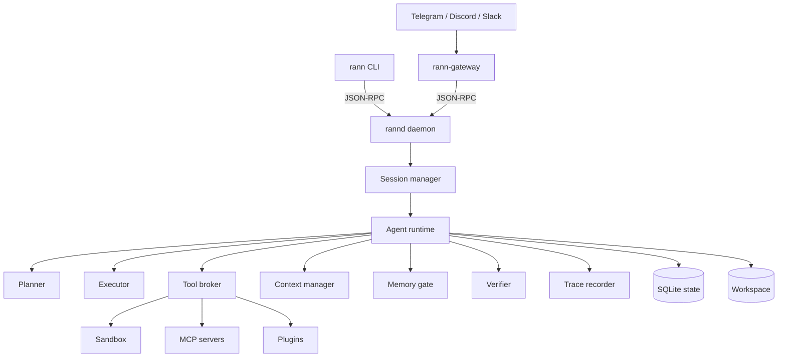
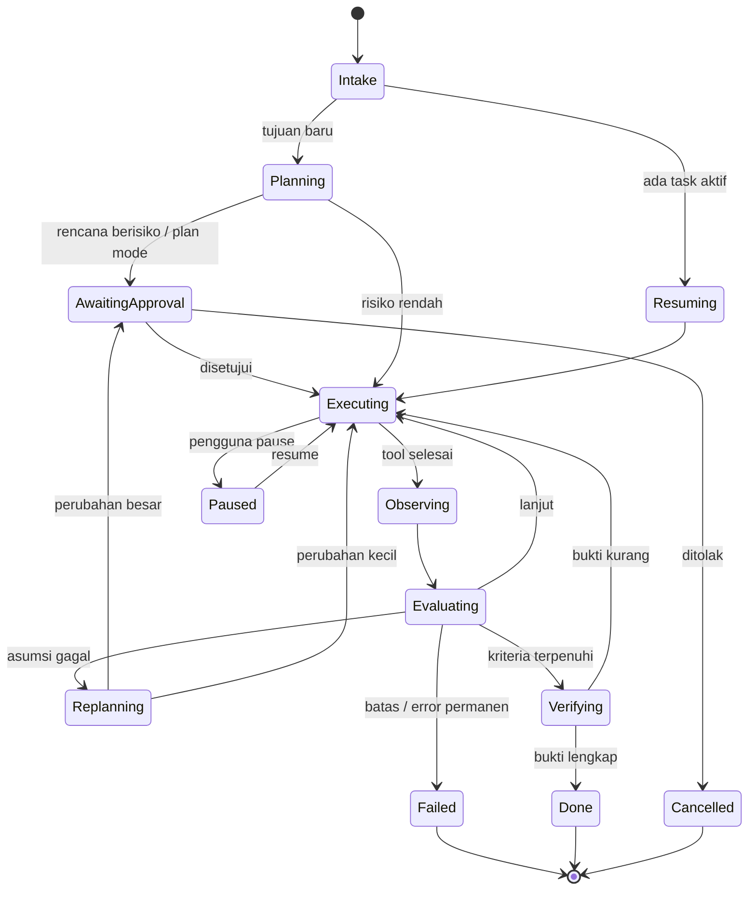
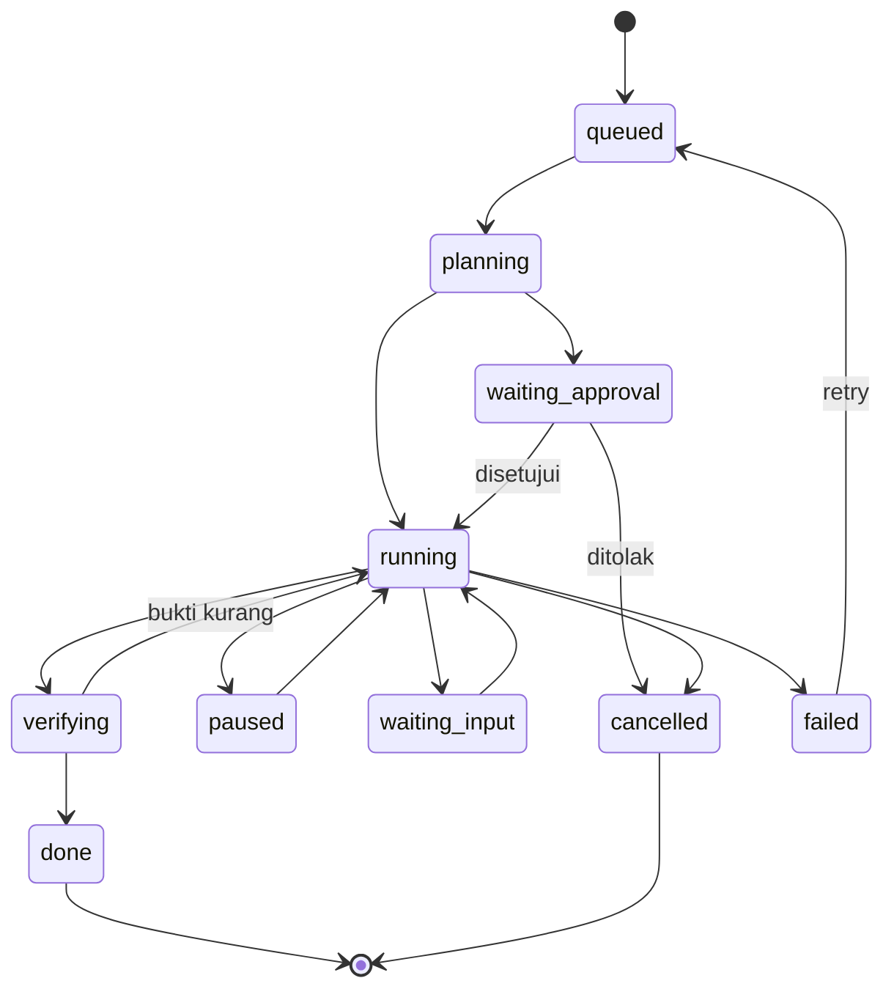

# 03. Agent Core, Planning, Coding Engine, dan Multi-Agent

- Dokumen induk: MASTER.md
- Versi: 1.0
- Requirement: RC-FR-021 sampai RC-FR-062
- Acceptance criteria: RC-AC-021 sampai RC-AC-062

## 12. Agent architecture

### 12.1 Tujuan dan batas

Agent core adalah mesin yang mengubah tujuan menjadi pekerjaan yang selesai dan terbukti. Ia bukan wrapper chat. Perbedaan yang mengikat:

- Chat berhenti setelah menghasilkan teks. Agent berhenti setelah kriteria selesai terpenuhi atau kegagalan dianalisis.
- Chat memilih satu jawaban. Agent memilih aksi, mengamati hasil, dan mengubah rencana.
- Chat tidak punya state. Agent punya goal, plan, task graph, checkpoint, dan trace yang persisten.

Batas yang disengaja: agent tidak boleh mengubah tujuannya sendiri, tidak boleh menaikkan permission-nya sendiri, dan tidak boleh menghapus audit trail. Ketiga larangan ini ditegakkan di runtime, bukan hanya di prompt.

### 12.2 Posisi dalam sistem



Agent runtime berjalan di daemon, bukan di proses CLI. Konsekuensinya: menutup terminal tidak mematikan task, dan gateway bisa mengakses sesi yang sama. CLI adalah klien tipis yang mengirim perintah dan merender event.

### 12.3 Komponen agent

| Komponen | Tanggung jawab | Tidak boleh dilakukan |
|---|---|---|
| Session | Mengikat percakapan, project, model, permission, dan budget | Menyimpan state global lintas sesi |
| Turn | Satu siklus input pengguna sampai agen berhenti atau menunggu | Melewati verifikasi |
| Planner | Membuat dan memperbarui DAG tugas | Menjalankan tool |
| Executor | Memilih aksi berikutnya dan memanggil tool | Mengubah izin |
| Tool broker | Validasi, izin, sandbox, timeout, retry, log | Menafsirkan tujuan |
| Context manager | Menyusun prompt dalam budget token | Mengambil memory tanpa filter |
| Memory gate | Menyaring kandidat memory dan retrieval | Menyimpan transkrip mentah |
| Verifier | Menentukan apakah kriteria selesai terpenuhi | Mengarang bukti |
| Trace recorder | Mencatat setiap keputusan dan hasil | Menghapus entri |
| Policy engine | Menilai risiko dan meminta approval | Memberi izin sendiri |

### 12.4 Execution loop

Loop berjalan sebagai state machine. State disimpan di database setiap transisi, sehingga proses bisa mati kapan saja dan dilanjutkan.



Pseudocode loop:

```ts
async function runTurn(turn: Turn): Promise<TurnResult> {
  let state = await loadState(turn);
  while (true) {
    assertBudget(state); // langkah, waktu, biaya, tool call
    const decision = await decideNextAction(state);

    switch (decision.kind) {
      case "call_tool": {
        const observation = await toolBroker.execute(decision.call, state);
        state = recordObservation(state, observation);
        break;
      }
      case "update_plan": {
        state = await planner.apply(state, decision.patch);
        break;
      }
      case "ask_user": {
        return pauseForInput(state, decision.question);
      }
      case "verify": {
        const evidence = await verifier.run(state.criteria, state);
        if (evidence.passed) return complete(state, evidence);
        state = recordGap(state, evidence);
        break;
      }
      case "finish": {
        const evidence = await verifier.requireEvidence(state);
        if (!evidence.passed) {
          state = recordGap(state, evidence);
          break;
        }
        return complete(state, evidence);
      }
      case "fail": {
        return failWithAnalysis(state, decision.reason);
      }
    }
  }
}
```

Aturan loop:

1. Setiap iterasi menghasilkan tepat satu aksi. Tidak ada batch tool yang tidak tercatat.
2. Aksi yang sama dengan argumen sama tidak diulang lebih dari dua kali. Percobaan ketiga harus mengubah strategi atau berhenti.
3. Model tidak boleh menyatakan selesai tanpa melewati verifier.
4. Jika model mengembalikan teks tanpa tool call saat tugas belum selesai, runtime menganggapnya sebagai `premature_finish` dan meminta verifikasi.
5. Setiap keputusan menyimpan `reason`, `confidence`, dan `evidence_refs`.

### 12.5 Klasifikasi tugas dan kedalaman eksekusi

Sebelum planning, runtime mengklasifikasikan tugas:

| Kelas | Ciri | Perilaku default |
|---|---|---|
| `answer` | Pertanyaan pengetahuan, tanpa perubahan state | Jawab langsung, tanpa plan |
| `inspect` | Baca repo, jelaskan, cari | Plan ringan 1 sampai 3 langkah, read-only |
| `modify` | Ubah file, jalankan tes | Plan wajib, checkpoint, verifikasi |
| `operate` | Jalankan sistem, deploy, gateway, scheduler | Plan wajib, approval, audit ketat |
| `research` | Sumber eksternal, perbandingan | Plan dengan sumber dan sitasi |
| `incident` | Ada kegagalan produksi | Debug flow, read-only dulu, mitigasi sebelum perbaikan |

Klasifikasi memakai sinyal: kata kerja, ada tidaknya path file, ada tidaknya error, permintaan verifikasi, dan permission mode. Klasifikasi bisa dikoreksi pengguna lewat `/plan new` atau `--class`.

### 12.6 Dynamic tool calling

Tool dipilih dari registry yang sudah difilter:

1. Filter berdasarkan permission sesi.
2. Filter berdasarkan kapabilitas model (tool calling, parallel tool call, structured output).
3. Filter berdasarkan konteks (tool browser hanya jika tugas butuh web, tool database hanya jika ada koneksi).
4. Urutkan kandidat berdasarkan kecocokan deskripsi, biaya, dan pengalaman sukses sebelumnya.
5. Kirim maksimal 32 tool ke model. Jika lebih, gunakan tool search dua tahap: cari tool, lalu muat skema lengkap.

Tool call dari model divalidasi terhadap JSON Schema. Argumen yang tidak valid tidak dijalankan; error dikembalikan ke model dengan path field yang salah. Model tidak diberi kesempatan untuk "memperbaiki" argumen secara diam-diam oleh runtime.

### 12.7 Observation dan evaluasi

Setiap hasil tool dinormalisasi menjadi `Observation`:

```ts
interface Observation {
  toolCallId: string;
  status: "ok" | "error" | "timeout" | "denied" | "cancelled";
  summary: string;          // maksimal 400 karakter, untuk prompt
  output?: string;          // maksimal 20.000 karakter, dipotong dengan artefak
  artifactRef?: string;     // file lengkap di blob store
  error?: { code: string; message: string; retryable: boolean };
  metrics: { durationMs: number; bytes: number; exitCode?: number };
  provenance: "tool" | "user" | "file" | "web" | "mcp";
}
```

Evaluasi membandingkan observasi dengan ekspektasi langkah:

- `success`: hasil sesuai kriteria langkah.
- `partial`: sebagian berhasil, lanjut dengan catatan.
- `failure_retryable`: ulangi dengan strategi berbeda.
- `failure_terminal`: hentikan langkah, replan atau gagal.
- `unexpected`: hasil valid tetapi mengubah asumsi, picu replanning.

### 12.8 Self-correction dan batasnya

Self-correction bukan "coba lagi sampai berhasil". Aturannya:

- Maksimal tiga siklus koreksi untuk masalah yang sama.
- Setiap siklus harus mengubah minimal satu variabel: pendekatan, tool, argumen, atau asumsi.
- Sebelum siklus ketiga, agen wajib membaca ulang error dan mencari penyebab di jalur bersama, bukan menambal gejala.
- Jika tiga siklus gagal, status `failed` dengan analisis, bukan loop keempat.
- Koreksi yang mengubah file di luar scope rencana memicu approval baru.

### 12.9 Retry dan error classification

| Kelas error | Contoh | Perilaku |
|---|---|---|
| Transient network | ECONNRESET, 502, 503, 504 | Retry 3 kali, backoff 1s, 2s, 4s, jitter 0 sampai 250 ms |
| Rate limit | 429 dengan Retry-After | Tunggu sesuai header, maksimal 60 detik, lalu fallback |
| Auth | 401, 403 | Tidak retry, minta login atau izin |
| Invalid request | 400, skema argumen salah | Tidak retry, koreksi argumen |
| Timeout tool | Melebihi timeout | Retry sekali dengan timeout lebih besar jika diizinkan |
| Crash tool | Exit code sinyal | Retry sekali, lalu laporkan |
| Conflict | File berubah sejak dibaca | Baca ulang, merge, atau eskalasi |
| Budget | Token, biaya, langkah habis | Berhenti, simpan state, lapor |

Retry tidak boleh menggandakan efek samping. Tool yang tidak idempoten wajib punya idempotency key atau tidak di-retry otomatis.

### 12.10 Goal tracking dan verifikasi

Goal disimpan sebagai objek terpisah:

```ts
interface Goal {
  id: string;
  statement: string;          // kalimat asli pengguna
  criteria: Criterion[];      // kriteria selesai yang bisa diuji
  constraints: string[];      // larangan, preferensi, batas
  createdAt: string;
  revisedAt?: string;
}
```

Kriteria selesai harus bisa diuji. Contoh buruk: "kode lebih baik". Contoh benar: "`pnpm test` lulus, `pnpm lint` tanpa error, endpoint mengembalikan 429 setelah 100 request per menit".

Verifier menjalankan pemeriksaan sesuai jenis kriteria:

| Jenis | Cara verifikasi |
|---|---|
| Test | Jalankan perintah tes, baca exit code dan ringkasan |
| Build | Jalankan build, cek artefak |
| Runtime | Jalankan perintah, cek output atau status |
| File | Baca ulang file, cocokkan pola atau hash |
| Diff | Periksa diff terhadap kriteria |
| Manual | Minta pengguna mengonfirmasi dengan pertanyaan spesifik |

Jika verifikasi tidak mungkin dijalankan (tidak ada tes, tidak ada akses runtime), laporan wajib menyebut "belum diverifikasi" dan alasannya. Ini lebih baik daripada klaim palsu.

### 12.11 Checkpoint dan pemulihan

Checkpoint dibuat:

- Sebelum setiap perubahan file.
- Sebelum perintah shell yang mengubah state.
- Sebelum spawn subagent yang menulis.
- Setiap 10 langkah untuk task panjang.

Isi checkpoint: snapshot file yang berubah (content-addressed), state task, plan version, konteks ringkas, dan posisi langkah. Untuk repo git, checkpoint juga mencatat HEAD dan index. Restore tidak mengubah commit pengguna; ia mengembalikan file dan state agent.

Pemulihan setelah crash:

1. Daemon start membaca `tasks` dengan status `running`.
2. Untuk setiap task, cek heartbeat terakhir dan lock.
3. Jika lock sudah mati, task ditandai `recovering`.
4. Runtime memuat checkpoint terakhir, memverifikasi hash file, lalu melanjutkan dari langkah berikutnya.
5. Tool yang statusnya `running` saat crash ditandai `unknown` dan tidak diulang otomatis kecuali idempoten.

### 12.12 Task state machine



Transisi divalidasi di satu fungsi. Tidak ada komponen yang boleh menulis status langsung ke database.

## 13. Planning system

### 13.1 Kapan planning dipakai

Planning wajib untuk kelas `modify`, `operate`, `research`, dan `incident`. Untuk `inspect`, plan ringan dibuat secara internal dan tidak selalu ditampilkan. Untuk `answer`, tidak ada plan.

Mode rencana eksplisit:

- `rann --plan "tujuan"` atau `/plan new "tujuan"`.
- Semua tool yang menulis, menjalankan shell, atau mengakses jaringan diblokir.
- Agen hanya boleh membaca, mencari, dan bertanya.
- Output berupa rencana Markdown plus DAG JSON.
- Eksekusi hanya setelah `/plan approve`.

### 13.2 Skema rencana

```json
{
  "planId": "plan_01J...",
  "version": 3,
  "goal": "Tambahkan rate limit per API key",
  "assumptions": [
    "Limit disimpan di Redis yang sudah ada",
    "Endpoint chat memakai middleware yang sama"
  ],
  "criteria": [
    {"id": "c1", "type": "test", "command": "pnpm test", "expect": "exit 0"},
    {"id": "c2", "type": "runtime", "command": "curl ...", "expect": "429 setelah 100 req"}
  ],
  "tasks": [
    {
      "id": "t1",
      "title": "Petakan middleware dan konfigurasi Redis",
      "agent": "coding",
      "dependsOn": [],
      "files": ["src/http/middleware/*.ts", "src/config/redis.ts"],
      "risk": "low",
      "acceptance": "Daftar middleware dan titik pasang rate limit"
    },
    {
      "id": "t2",
      "title": "Implementasi rate limiter",
      "agent": "coding",
      "dependsOn": ["t1"],
      "files": ["src/http/middleware/rate-limit.ts"],
      "risk": "medium",
      "acceptance": "Fungsi limiter dan unit test"
    },
    {
      "id": "t3",
      "title": "Integrasi dan tes endpoint",
      "agent": "testing",
      "dependsOn": ["t2"],
      "files": ["src/http/chat.ts", "test/chat.test.ts"],
      "risk": "medium",
      "acceptance": "Tes lulus dan perilaku 429 terbukti"
    }
  ],
  "estimate": {"minutes": [20, 45], "costUsd": [0.05, 0.25]},
  "risks": [
    {"taskId": "t2", "level": "medium", "reason": "Menyentuh jalur request utama"}
  ]
}
```

Validasi rencana:

- Setiap task punya minimal satu acceptance criterion.
- DAG tidak boleh memiliki siklus.
- File yang sama tidak boleh dimiliki dua task paralel tanpa lease.
- Task tanpa dependensi dan tanpa file boleh berjalan paralel.
- Estimasi wajib berupa rentang, bukan angka tunggal.
- Rencana yang menyentuh lebih dari 20 file atau menghapus file memerlukan approval eksplisit.

### 13.3 Algoritma planning

1. Baca goal, kriteria, constraint, dan konteks project.
2. Klasifikasikan tugas dan tentukan apakah perlu eksplorasi tambahan.
3. Jalankan eksplorasi read-only secukupnya: struktur repo, file terkait, tes, konfigurasi.
4. Hasilkan kandidat task dari model dengan skema JSON.
5. Validasi skema dan DAG. Jika invalid, minta model memperbaiki maksimal dua kali.
6. Anotasi risiko berdasarkan path, perintah, jaringan, dan biaya.
7. Cek konflik file dan tambahkan dependensi atau lease.
8. Estimasi rentang waktu dan biaya berdasarkan histori tool call.
9. Tampilkan ringkasan dan minta approval jika perlu.
10. Simpan versi rencana dan mulai eksekusi.

### 13.4 Replanning

Replanning dipicu oleh:

- Tool gagal terminal.
- File berubah di luar dugaan.
- Tes mengungkap masalah baru.
- Pengguna mengubah requirement.
- Biaya atau waktu melampaui estimasi 2x.
- Subagent melaporkan konflik yang tidak bisa diselesaikan.

Aturan:

- Rencana lama tidak dihapus. Versi baru menunjuk `supersedes`.
- Perubahan yang menambah file atau menaikkan risiko memicu approval.
- Perubahan yang hanya mengganti urutan atau tool tidak memicu approval, tetapi dicatat.
- Alasan replanning ditulis dalam satu kalimat yang bisa diaudit.

### 13.5 Progress dan deviasi

Progress dihitung dari task yang `done` dibagi total task, bukan dari jumlah langkah. Setiap task punya status sendiri. Deviasi dihitung dari:

- Task yang belum mulai padahal dependensi sudah selesai.
- Perubahan estimasi lebih dari 50 persen.
- File yang disentuh di luar daftar.
- Retry lebih dari dua kali.

Deviasi ditampilkan di `/plan show` dan dashboard. Jika deviasi tinggi, agen memberi ringkasan, bukan diam.

## 14. Coding engine

### 14.1 Repository model

Repo diindeks menjadi empat lapisan:

| Lapisan | Isi | Dibangun kapan |
|---|---|---|
| File tree | Path, ukuran, bahasa, hash | Saat start dan saat file berubah |
| Symbol index | Fungsi, kelas, tipe, ekspor, referensi | Saat index build, inkremental via watcher |
| Text index | FTS5 untuk isi file dan komentar | Saat index build, inkremental |
| Vector index | Embedding potongan kode dan dokumen | Saat index build, opsional untuk repo besar |

Indeks disimpan di SQLite yang sama dengan state, tetapi di tabel terpisah agar bisa dibangun ulang tanpa menyentuh data sesi. File yang diabaikan: `.git`, `node_modules`, `dist`, `build`, `.venv`, `target`, dan pola `.gitignore`.

Bahasa yang didukung penuh untuk symbol index: TypeScript, JavaScript, Python, Go, Rust, Java, Kotlin, PHP, C#, Ruby, C, C++. Bahasa lain memakai text index dan fallback regex.

### 14.2 Alur eksplorasi

Saat menerima tugas coding, agen tidak membaca seluruh repo. Urutannya:

1. Baca manifest dan README untuk memahami stack.
2. Cari file yang disebut pengguna atau error.
3. Cari simbol terkait dan pemanggilnya.
4. Baca file terkait dengan rentang baris, bukan seluruh file jika besar.
5. Baca tes yang ada untuk memahami kontrak.
6. Baru buat rencana perubahan.

Batas konteks: maksimal 12 file per giliran, maksimal 40.000 token untuk file. Jika lebih, agen memilih file paling relevan dan menyebut yang belum dibaca.

### 14.3 Patch protocol

Perubahan file tidak boleh berupa "tulis ulang seluruh file" kecuali file baru atau file di bawah 40 baris. Protokol patch:

```json
{
  "path": "src/auth/session.ts",
  "expectedHash": "sha256:...",
  "edits": [
    {
      "find": "const SESSION_TTL = 60 * 60;",
      "replace": "const SESSION_TTL = 15 * 60;",
      "occurrence": 1
    }
  ],
  "reason": "Memperpendek TTL sesuai requirement"
}
```

Langkah eksekusi:

1. Validasi path ada di workspace dan permission mengizinkan.
2. Baca file, hitung hash, bandingkan dengan `expectedHash`.
3. Cari `find`. Jika tidak ditemukan atau lebih dari satu occurrence tanpa `occurrence`, tolak.
4. Terapkan replace pada salinan di memori.
5. Tulis ke file sementara di direktori yang sama, fsync, lalu rename atomik.
6. Baca ulang file dan verifikasi hasil.
7. Catat diff dan checkpoint.

Jika langkah 3 atau 6 gagal, file asli tidak berubah. Error dikembalikan dengan konteks sekitar dan saran.

Untuk perubahan multi-file, semua patch disiapkan dalam staging area logis. Eksekusi:

1. Kunci path dengan lease.
2. Terapkan semua patch ke salinan.
3. Jalankan pemeriksaan sintaks dan lint cepat jika tersedia.
4. Jika semua lolos, commit ke filesystem secara berurutan.
5. Jika satu gagal, batalkan semua kecuali pengguna memilih partial.

Tidak ada patch yang diterapkan langsung ke file asli tanpa verifikasi.

### 14.4 Gaya kode

Sebelum menulis, agen mendeteksi:

- Indentasi dan lebar baris dari file sekitar.
- Kutip tunggal atau ganda.
- Titik koma.
- Konvensi penamaan.
- Pola error (throw, Result, error callback).
- Versi bahasa dan fitur yang tersedia.

Jika repo punya formatter, formatter menang atas preferensi model. Agen menjalankan formatter setelah patch dan menyertakan perubahannya dalam diff.

### 14.5 Verifikasi bertingkat

Urutan verifikasi dari termurah ke termahal:

1. Parse atau typecheck file yang berubah.
2. Lint file yang berubah.
3. Unit test yang terkait.
4. Test suite penuh.
5. Build.
6. Runtime smoke test.

Agen memilih tingkat yang relevan dengan perubahan. Perubahan satu fungsi tidak perlu build seluruh monorepo jika typecheck dan unit test sudah cukup. Namun klaim "selesai" harus menyebut tingkat yang dijalankan dan yang tidak.

### 14.6 Debugging

Alur debugging yang mengikat:

1. Reproduksi dengan input atau perintah yang diberikan.
2. Baca error lengkap, termasuk stack trace dan log sekitar.
3. Verifikasi asumsi dasar: versi, env, file yang dimuat, data yang masuk.
4. Telusuri alur dari input ke titik gagal.
5. Cari pemanggil dan kontrak yang dilanggar.
6. Perbaiki di jalur bersama, bukan di gejala.
7. Jalankan ulang reproduksi yang sama.
8. Tambahkan tes regresi jika belum ada.

Agen tidak boleh menambal dengan `try/catch` kosong, menonaktifkan tes, atau menaikkan timeout tanpa menjelaskan akar masalah.

### 14.7 Test generation

Tes yang dihasilkan harus:

- Menguji perilaku publik, bukan implementasi internal.
- Memiliki minimal satu kasus sukses dan satu kasus gagal.
- Tidak bergantung pada waktu nyata, jaringan, atau urutan eksekusi.
- Menggunakan fixture yang sudah ada di repo jika tersedia.
- Bisa dijalankan ulang tanpa state tersisa.

Jika repo tidak punya test runner, agen mengusulkan satu dan meminta persetujuan sebelum menambah dependency.

### 14.8 Build dan dependency

Adapter ekosistem mendeteksi perintah dari manifest:

| Ekosistem | Deteksi | Perintah default |
|---|---|---|
| Node | package.json, lockfile | `pnpm test`, `pnpm build`, `pnpm lint` |
| Python | pyproject.toml, requirements.txt | `pytest`, `ruff`, `mypy` |
| Go | go.mod | `go test ./...`, `go build ./...` |
| Rust | Cargo.toml | `cargo test`, `cargo build` |
| PHP | composer.json | `composer test`, `phpstan` |
| Java | pom.xml, build.gradle | `mvn test`, `gradle test` |
| .NET | *.csproj | `dotnet test`, `dotnet build` |

Jika perintah tidak ada, agen tidak mengarang. Ia melaporkan bahwa verifikasi tidak tersedia dan meminta pengguna menentukan perintah.

Instalasi dependency:

- Baca manifest dan lockfile lebih dulu.
- Tampilkan paket, versi, dan alasan.
- Minta persetujuan.
- Jalankan instalasi dengan network permission.
- Catat perubahan lockfile dan hash.
- Jika gagal, kembalikan lockfile ke kondisi semula.

### 14.9 Code review

Review menghasilkan temuan terstruktur:

```ts
interface Finding {
  severity: "blocker" | "high" | "medium" | "low" | "nit";
  category: "bug" | "security" | "performance" | "test" | "style" | "design";
  file: string;
  line: number;
  message: string;
  evidence: string;
  suggestion?: string;
}
```

Aturan: setiap temuan harus menunjuk baris dan menjelaskan dampaknya. Tidak ada temuan generik seperti "kode bisa lebih baik". Jika tidak ada temuan, review menyebut apa yang diperiksa dan tes apa yang dijalankan.

### 14.10 Project initialization

`rann init` membuat:

- `RANN.md` berisi ringkasan project, perintah build dan test, konvensi, dan larangan.
- `.rann/config.json` berisi model default, permission mode, dan index settings.
- `.rann/rules/` kosong dengan contoh aturan.
- `.gitignore` ditambah `.rann/cache/` dan `.rann/local/`.

Inisialisasi tidak menimpa file yang sudah ada. Jika `RANN.md` ada, command menampilkan diff dan meminta konfirmasi.

## 15. Multi-agent architecture

### 15.1 Kapan subagent dipakai

Subagent dipakai ketika:

- Pekerjaan bisa dipecah menjadi bagian independen.
- Konteks parent akan terlalu besar jika dikerjakan sendiri.
- Dibutuhkan spesialisasi tool atau model.
- Pekerjaan bisa diverifikasi secara terpisah.

Subagent tidak dipakai untuk:

- Tugas yang hanya satu tool call.
- Tugas yang membutuhkan konteks percakapan penuh dan tidak bisa diringkas.
- Tugas yang mengubah file yang sama dengan parent tanpa koordinasi.

Keputusan spawn dicatat dengan alasan. Jika ragu, parent mengerjakan sendiri.

### 15.2 Profil agent

```markdown
---
name: security
description: Audit keamanan, threat model, dan review kode sensitif
model: auto
tools: [read_file, search_code, shell, git_diff, web_search]
permissions: read-only
maxTurns: 30
budgetUsd: 0.50
---
Kamu adalah auditor keamanan. Fokus pada autentikasi, otorisasi, injeksi,
kebocoran secret, dan jalur eskalasi. Setiap temuan harus punya bukti.
```

Profil disimpan di `~/.rann/agents/*.md`, `.rann/agents/*.md`, atau plugin. Profil tidak bisa menaikkan permission di luar izin sesi parent.

Profil bawaan: `architect`, `research`, `coding`, `frontend`, `backend`, `testing`, `security`, `reviewer`, `docs`. Profil ini adalah titik awal, bukan batas.

### 15.3 Topologi tim

| Topologi | Kapan dipakai | Koordinasi |
|---|---|---|
| Solo | Tugas kecil | Tidak ada subagent |
| Lead-worker | Pekerjaan paralel independen | Lead memecah, worker melapor |
| Peer review | Perubahan berisiko | Satu mengerjakan, satu mengaudit |
| Pipeline | Tahapan berurutan | Output tahap menjadi input tahap berikut |
| Swarm terbatas | Eksplorasi banyak hipotesis | Maksimal 8 worker, hasil diperingkat |

Hierarki maksimal tiga tingkat. Seorang worker tidak boleh spawn lebih dari 4 helper. Total agen aktif dibatasi konfigurasi (default 8, maksimal 32).

### 15.4 Spawn protocol

Parent mengirim `SpawnRequest`:

```json
{
  "parentTaskId": "task_01J...",
  "profile": "security",
  "goal": "Audit endpoint upload",
  "context": {
    "summary": "Endpoint baru di src/http/upload.ts, memakai multer",
    "files": ["src/http/upload.ts", "src/http/auth.ts"],
    "decisions": ["Upload disimpan di S3, bukan disk lokal"],
    "constraints": ["Jangan ubah kode, hanya laporkan"]
  },
  "acceptance": ["Daftar temuan dengan severity dan bukti"],
  "budget": {"maxTurns": 30, "maxUsd": 0.50},
  "tools": ["read_file", "search_code", "shell"],
  "workspace": "read-only"
}
```

Anak menerima konteks terbatas, bukan seluruh transkrip. Anak mengembalikan `AgentResult`:

```json
{
  "status": "done",
  "summary": "3 temuan: 1 high, 2 medium",
  "findings": ["..."],
  "artifacts": ["artifact://sha256/..."],
  "usage": {"tokens": 18400, "costUsd": 0.12},
  "unresolved": ["Perlu uji runtime untuk memastikan bypass"]
}
```

Jika anak gagal, parent menerima error dan ringkasan langkah terakhir. Parent memutuskan retry, ganti profil, atau kerjakan sendiri.

### 15.5 Komunikasi antar agen

Pesan memakai skema:

```ts
interface AgentMessage {
  id: string;
  from: string;
  to: string;
  kind: "request" | "response" | "escalation" | "cancel";
  subject: string;
  body: string;          // maksimal 4.000 karakter
  refs: string[];        // artefak atau task id
  createdAt: string;
}
```

Aturan:

- Pesan tidak boleh mengirim transkrip mentah atau secret.
- Eskalasi ke parent selalu menyertakan satu keputusan yang diminta.
- Broadcast hanya untuk pembatalan, bukan diskusi.
- Setiap pesan dicatat di `agent_messages` dan bisa dilihat di `/agent logs`.

### 15.6 Shared dan isolated context

Shared context berisi:

- Goal dan kriteria selesai.
- Keputusan arsitektur yang sudah disetujui.
- Daftar file dan lease.
- Hasil verifikasi.
- Ringkasan artefak.

Isolated context berisi:

- Langkah dan observasi lokal.
- Hipotesis yang belum terbukti.
- Draft yang belum disetujui.

Anak tidak bisa membaca transkrip parent. Parent tidak otomatis membaca transkrip anak; ia membaca ringkasan dan artefak. Ini mencegah konteks meledak dan mencegah halusinasi menular.

### 15.7 Pencegahan konflik file

Tiga lapis:

1. **Path lease.** Sebelum menulis, agen meminta lease `file:src/auth.ts` dengan TTL 10 menit dan heartbeat. Lease kedua ditolak atau diantrekan.
2. **Optimistic concurrency.** Patch membawa `expectedHash`. Jika hash berubah, patch ditolak.
3. **Merge queue.** Jika dua agen perlu mengubah file yang sama, perubahan diterapkan berurutan. Agen kedua menerima diff terbaru dan harus rebase patch-nya.

Jika konflik tidak selesai dalam dua percobaan, parent menerima eskalasi berisi kedua patch dan diff. Parent memilih, atau meminta pengguna.

### 15.8 Lifecycle dan recovery

Status agen: `spawned`, `running`, `waiting`, `paused`, `cancelling`, `cancelled`, `done`, `failed`, `orphaned`.

- Heartbeat setiap 5 detik.
- Jika heartbeat hilang 30 detik, agen ditandai `orphaned`.
- Daemon recovery menandai agen `orphaned` sebagai `failed` dan melepas lease-nya.
- Task yang dikerjakan agen bisa di-retry oleh parent.
- Resource (proses, browser, container) dibersihkan saat agen selesai, gagal, atau dibatalkan.

### 15.9 Monitoring dan biaya

`/agents` menampilkan pohon, status, langkah, token, biaya, dan file lease. Dashboard menampilkan hal yang sama secara realtime. Setiap agen punya budget sendiri; total biaya anak tidak boleh melebihi budget parent. Jika budget parent habis, semua anak dibatalkan dengan status `budget_exhausted`.

### 15.10 Kualitas hasil

Sebelum parent menerima hasil anak:

- Status harus `done` atau `failed`, bukan `running`.
- Ringkasan harus menyebut apa yang dikerjakan dan apa yang tidak.
- Artefak harus bisa diakses.
- Klaim harus punya bukti (file, perintah, output).
- Jika anak mengklaim sukses tanpa bukti, parent menandai `unverified` dan meminta verifikasi tambahan.

Parent tidak boleh menyalin klaim anak ke laporan akhir tanpa memeriksa bukti.
