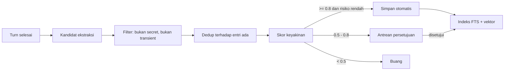
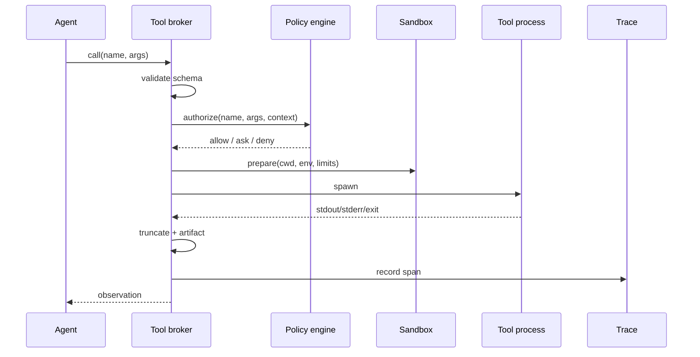

# 04. Memory, Instruksi, Skills, Tools, MCP, Plugin, dan Hooks

- Dokumen induk: MASTER.md
- Versi: 1.0
- Requirement: RC-FR-063 sampai RC-FR-100
- Acceptance criteria: RC-AC-063 sampai RC-AC-100

## 16. Memory architecture

### 16.1 Prinsip

Memory bukan arsip percakapan. Memory adalah kumpulan fakta, keputusan, preferensi, dan prosedur yang sudah diseleksi, punya sumber, dan bisa dicabut. Tiga aturan yang mengikat:

1. Tidak ada penulisan memory tanpa sumber. Setiap entri menyimpan `source_session_id`, `source_message_id`, atau `source_path`.
2. Tidak ada memory yang masuk prompt tanpa melewati filter lingkup dan budget.
3. Tidak ada penghapusan memory tanpa jejak audit.

Memory yang salah harus bisa dikoreksi dalam satu perintah. Memory yang tidak lagi relevan harus kedaluwarsa, bukan menumpuk selamanya.

### 16.2 Enam ruang memory

| Ruang | Isi | Lingkup | Umur default | Contoh |
|---|---|---|---|---|
| User | Preferensi, gaya kerja, identitas, larangan | Semua project profil | Permanen sampai diubah | "Tidak memakai em dash" |
| Project | Arsitektur, perintah build, konvensi, keputusan | Satu project | Sampai project diarsipkan | "Project ini memakai pnpm" |
| Session | Tujuan, keputusan sementara, hasil verifikasi | Satu sesi | 30 hari | "Coba pendekatan cache dulu" |
| Agent | Pelajaran dari tugas agen tertentu | Profil agen | 90 hari | "Repo ini butuh Node 22" |
| Knowledge | Dokumen, ADR, catatan yang diindeks | Project atau global | Mengikuti dokumen | "ADR-003 memilih SQLite" |
| Procedural | Cara melakukan sesuatu, langkah yang terbukti | Global atau project | Permanen dengan versi | "Cara deploy staging" |

Ruang bukan tabel terpisah. Semua entri berada di tabel `memories` dengan kolom `scope`. Pemisahan ruang ditegakkan di query dan permission.

### 16.3 Skema entri

```ts
interface MemoryEntry {
  id: string;                 // mem_<ulid>
  scope: "user" | "project" | "session" | "agent" | "knowledge" | "procedural";
  projectId?: string;
  sessionId?: string;
  agentProfile?: string;
  kind: "fact" | "preference" | "decision" | "procedure" | "lesson" | "reference";
  title: string;              // <= 120 karakter
  content: string;            // <= 4.000 karakter
  tags: string[];
  confidence: number;         // 0..1
  importance: number;         // 0..1, dipakai untuk prioritas
  source: {
    type: "message" | "file" | "tool" | "manual" | "import";
    ref: string;
    excerpt?: string;
  };
  createdAt: string;
  updatedAt: string;
  lastUsedAt?: string;
  useCount: number;
  expiresAt?: string;
  supersedes?: string;
  hash: string;               // sha256 dari title + content ternormalisasi
  embeddingModel?: string;
  embeddingRef?: string;
}
```

Aturan validasi:

- `title` tidak boleh kosong dan tidak boleh hanya berisi path.
- `content` harus mandiri, bisa dipahami tanpa percakapan asal.
- `confidence` di bawah 0,5 tidak masuk otomatis; menunggu persetujuan.
- `importance` dihitung dari pin, jenis, dan frekuensi pakai, bukan dari panjang teks.
- Entri dengan `hash` sama di scope yang sama dianggap duplikat.

### 16.4 Pipeline ekstraksi

Ekstraksi berjalan setelah giliran selesai, bukan di tengah streaming.



Kandidat yang layak:

- Preferensi yang dinyatakan eksplisit ("selalu pakai pnpm").
- Keputusan arsitektur yang disetujui ("pakai SQLite, bukan Postgres").
- Fakta project yang stabil ("test runner adalah vitest").
- Pelajaran dari kegagalan ("build gagal jika NODE_ENV tidak diset").
- Prosedur yang berhasil dan bisa diulang.

Kandidat yang ditolak:

- Isi file atau output tool mentah.
- Secret, token, password, nomor kartu.
- Data pribadi yang tidak relevan dengan pekerjaan.
- Instruksi sementara ("untuk sekarang", "coba dulu").
- Hal yang sudah ada di dokumentasi project.

Ekstraksi memakai model murah (router memilih kelas `extraction`), dengan prompt yang meminta JSON. Jika model gagal, ekstraksi dilewati dan dicatat, bukan diulang tanpa batas.

### 16.5 Retrieval

Retrieval memakai tiga jalur:

1. **FTS5** untuk pencocokan kata dan frasa, dengan tokenizer porter dan trigram untuk substring.
2. **Vektor** untuk kemiripan semantik, memakai `sqlite-vec` dengan jarak cosine.
3. **Graph** untuk entri yang terhubung (`supersedes`, `related_to`, tag yang sama).

Penggabungan memakai reciprocal rank fusion:

```
score(d) = Σ_j 1 / (k + rank_j(d)), k = 60
```

Lalu skor dikalikan bobot:

- `scope_match`: 1,0 jika scope sesuai, 0,3 jika global.
- `importance`: 0,8 sampai 1,2.
- `recency`: decay halus, bukan cliff.
- `confidence`: 0,5 sampai 1,0.

Filter wajib:

- `projectId` harus cocok atau null untuk global.
- `sessionId` hanya untuk sesi yang sama.
- Entri yang kedaluwarsa tidak diambil.
- Entri yang ditandai `contradicted` hanya diambil jika query meminta sejarah.

Batas hasil: maksimal 12 entri atau 2.500 token, mana yang lebih dulu. Jika tidak ada hasil di atas ambang 0,25, tidak ada memory yang disuntikkan. Agen diberi tahu bahwa tidak ada memory relevan, bukan diberi entri acak.

### 16.6 Embedding

- Model embedding dikonfigurasi terpisah dari model chat.
- Default: provider yang sama dengan chat jika mendukung embedding, jika tidak maka provider embedding khusus.
- Dimensi dan nama model disimpan di metadata indeks.
- Jika model berubah, indeks lama tidak dipakai. Sistem menandai `needs_reindex` dan memberi progres.
- Embedding dibuat asinkron di background queue, tidak memblokir penyimpanan entri.
- Entri tetap bisa dicari lewat FTS sebelum embedding selesai.

### 16.7 Konsolidasi dan deduplikasi

Konsolidasi berjalan terjadwal (default harian) dan saat jumlah entri scope melewati ambang.

Aturan:

- Dua entri dengan kemiripan di atas 0,92 dan scope sama digabung.
- Entri yang saling bertentangan ditandai `contradiction` dengan referensi keduanya. Yang lebih baru tidak otomatis menang; pengguna atau agen memutuskan.
- Entri yang tidak pernah dipakai 180 hari dan importance di bawah 0,3 ditandai `stale`, tidak langsung dihapus.
- Prosedur yang diperbarui menyimpan versi lama di `memory_versions`.

### 16.8 Masa berlaku dan decay

| Jenis | Default | Bisa diubah |
|---|---|---|
| Preference | Permanen | Ya |
| Decision | Permanen sampai digantikan | Ya |
| Session | 30 hari | Ya |
| Agent lesson | 90 hari | Ya |
| Knowledge | Mengikuti dokumen | Ya |
| Procedure | Permanen dengan versi | Ya |

Decay hanya memengaruhi skor retrieval, bukan menghapus data. Entri `stale` masih bisa dicari dengan `/memory search --include-stale`.

### 16.9 Koreksi dan penghapusan

`/memory edit mem_...` membuka editor. Saat disimpan:

1. Validasi skema.
2. Hitung hash baru.
3. Simpan versi lama di `memory_versions`.
4. Perbarui entri.
5. Perbarui FTS dan vektor dalam transaksi yang sama.

Penghapusan:

- `soft`: set `deleted_at`, hapus dari indeks, tetap ada untuk audit 30 hari.
- `hard`: hapus baris dan versi, hanya untuk permintaan privasi atau data sensitif.
- Keduanya mencatat aktor, alasan, dan waktu di audit log.

### 16.10 Import dan export

Format JSONL:

```json
{"id":"mem_01J...","scope":"project","kind":"decision","title":"Pakai SQLite","content":"...","tags":["storage"],"confidence":0.95,"importance":0.8,"source":{"type":"manual","ref":"/memory"},"createdAt":"2026-11-05T01:00:00Z"}
```

Aturan:

- Export menyertakan versi skema di baris pertama.
- Import memvalidasi setiap baris. Baris invalid dilaporkan, tidak menggagalkan seluruh file kecuali `--strict`.
- Konflik id: `skip`, `overwrite`, atau `merge` (default `skip`).
- Import tidak pernah menimpa entri dengan scope berbeda tanpa `--force`.

### 16.11 Inspeksi

`/memory list` menampilkan id pendek, scope, kind, title, umur, dan status. `/memory show` menampilkan isi, sumber, versi, dan skor retrieval terakhir. Dashboard menampilkan tabel yang sama dengan filter dan editor.

### 16.12 Indeks pengetahuan project

`.rann/knowledge/` berisi Markdown, ADR, dan catatan. Saat `rann index build`:

1. File dipecah per heading dengan overlap 10 persen.
2. Setiap potongan menyimpan path, heading, rentang baris, dan hash.
3. Potongan di-embed dan dimasukkan ke FTS.
4. Sitasi memakai `path#heading` dan baris.

Knowledge berbeda dari memory: isinya dokumen utuh, bukan fakta yang diekstrak. Agen boleh mengutip knowledge, tetapi tidak boleh mengubahnya tanpa persetujuan.

### 16.13 Privasi dan lingkup

- Memory user tidak dibaca oleh project yang berbeda kecuali pengguna mengizinkan.
- Memory session tidak dibaca oleh sesi lain.
- Memory agent hanya dibaca oleh profil agen yang sama.
- Secret tidak pernah menjadi memory. Pipeline ekstraksi memakai detektor pola dan menolak kandidat yang mengandung kredensial.
- Export dan dashboard memakai redaction untuk email, nomor telepon, dan token.

## 17. Instruction system

### 17.1 File instruksi

| File | Lingkup | Prioritas | Dibaca otomatis |
|---|---|---|---|
| `RANN.md` | Project | 90 | Ya |
| `AGENTS.md` | Project, kompatibilitas | 80 | Ya |
| `CLAUDE.md` | Project, kompatibilitas | 70 | Ya |
| `.rann/rules/*.md` | Path tertentu | 60 | Ya jika path cocok |
| `~/.rann/RANN.md` | Global profil | 50 | Ya |
| `~/.rann/agents/<nama>.md` | Profil agen | 40 | Saat agen aktif |
| System prompt internal | Runtime | 100 | Selalu |

Prioritas lebih tinggi menang saat ada konflik, kecuali konflik menyangkut keamanan: larangan dari policy engine selalu menang.

### 17.2 Urutan loading

1. System prompt internal (identitas, aturan tool, keamanan).
2. Instruksi global profil.
3. Instruksi project dari root ke direktori kerja.
4. Aturan path yang cocok dengan file yang sedang dikerjakan.
5. Instruksi agen jika berjalan sebagai subagent.
6. Instruksi skill yang aktif.
7. Pesan pengguna.

Setiap lapisan diberi label sumber di prompt. Model tidak boleh mencampur instruksi dari file yang tidak relevan.

### 17.3 Inheritance dan scope

- Global berlaku untuk semua project.
- Project berlaku untuk semua subdirektori.
- File di subdirektori hanya berlaku untuk path di bawahnya.
- `.rann/rules/api.md` dengan frontmatter `paths: ["src/api/**"]` hanya dimuat saat agen menyentuh path itu.
- Aturan yang lebih spesifik menang atas aturan umum.

### 17.4 Konflik

Konflik terjadi ketika dua instruksi memberikan perintah yang bertentangan. Resolusi:

1. Jika salah satu instruksi melanggar keamanan, instruksi itu diabaikan dan dicatat.
2. Jika konflik tentang gaya, aturan path yang lebih spesifik menang.
3. Jika konflik tentang tujuan, instruksi pengguna di giliran aktif menang.
4. Jika masih ambigu, agen bertanya satu pertanyaan spesifik.

Trace mencatat: `instruction_conflict` dengan sumber A, sumber B, pemenang, dan alasan.

### 17.5 Kompatibilitas format

Rann Code membaca:

- `RANN.md`, `AGENTS.md`, `CLAUDE.md` sebagai Markdown biasa.
- Frontmatter YAML pada aturan, skill, agent, dan command.
- `.claude/rules/*.md` dengan sintaks yang sama.
- `CLAUDE.md` tidak diubah. Jika pengguna ingin migrasi, `/init --migrate` menawarkan penyalinan ke `RANN.md` dengan diff.

### 17.6 Ukuran dan pemotongan

- Total instruksi yang dimuat maksimal 8.000 token.
- File di atas 2.000 token diringkas dengan menyebut path dan bagian yang dipotong.
- Instruksi yang tidak relevan dengan tugas tidak dimuat.
- `/context show` menampilkan instruksi mana yang masuk dan berapa token.

## 18. Skills system

### 18.1 Format skill

```markdown
---
name: deploy-staging
description: Deploy build ke staging dan verifikasi health. Gunakan saat user minta deploy staging.
version: 1.2.0
license: MIT
allowed-tools: [shell, http, read_file]
requires:
  tools: [shell]
  packages: []
  skills: []
  rann: ">=1.0.0"
metadata:
  category: deployment
  author: rann
---
# Deploy Staging

## Langkah
1. Pastikan working tree bersih.
2. Jalankan `pnpm build`.
3. Jalankan `scripts/deploy.sh staging`.
4. Cek `GET /health` sampai 200, maksimal 60 detik.
5. Laporkan commit hash dan versi.

## Jika gagal
- Build gagal: tampilkan error, jangan deploy.
- Health gagal: rollback ke versi sebelumnya dan laporkan.
```

Aturan:

- `name` unik, huruf kecil, tanda hubung.
- `description` maksimal 200 karakter dan memuat trigger.
- `allowed-tools` membatasi tool yang boleh dipakai skill.
- `requires` divalidasi sebelum aktivasi.
- Badan skill berisi instruksi, bukan kode rahasia.

### 18.2 Discovery dan progressive loading

Lapisan pemuatan:

1. **Metadata**: nama, deskripsi, versi, requires, path. Selalu dimuat untuk semua skill (maksimal 200 skill).
2. **Body**: SKILL.md penuh, dimuat saat skill dipilih atau sangat relevan.
3. **Resources**: file referensi, skrip, template, dimuat hanya saat dirujuk.

Jika jumlah skill melebihi 200, sistem mengelompokkan berdasarkan kategori dan hanya memuat metadata kategori yang relevan.

### 18.3 Aktivasi

Skill dipilih jika:

- Pengguna menyebut nama skill.
- Deskripsi cocok dengan tugas (skor di atas ambang).
- Command `/skill run` memanggilnya.
- Agen memutuskan butuh prosedur setelah gagal dengan pendekatan umum.

Aktivasi mencatat alasan dan versi. Skill yang aktif tidak otomatis mengikat seluruh giliran; ia dimuat sebagai instruksi tambahan dan bisa dilepas.

### 18.4 Eksekusi

Skill bisa berisi:

- Instruksi Markdown yang diikuti model.
- Skrip di `scripts/` yang dijalankan dengan interpreter terdeteksi.
- Tool yang dideklarasikan di `allowed-tools`.

Saat menjalankan skrip:

- Working directory adalah root skill atau project, ditentukan manifest.
- Env dibatasi, tanpa secret kecuali dideklarasikan.
- Timeout default 120 detik.
- Output dipotong 20.000 karakter dengan artefak.
- Exit code non-zero menghasilkan error yang bisa dikoreksi.

### 18.5 Pembuatan dan validasi

`/create-skill` memakai sesi saat ini sebagai sumber. Alur:

1. Ekstrak langkah yang berhasil dan keputusan penting.
2. Buat nama dan deskripsi dengan trigger.
3. Tulis SKILL.md dan skrip pendamping jika perlu.
4. Validasi frontmatter, nama unik, dan tool yang tersedia.
5. Jalankan dry-run pada kasus sederhana jika memungkinkan.
6. Tampilkan diff dan minta persetujuan sebelum menyimpan.

Validasi menolak:

- Deskripsi tanpa trigger.
- Tool yang tidak ada.
- Skrip dengan shebang yang tidak didukung.
- Skill yang mencoba mengakses path di luar workspace tanpa deklarasi.

### 18.6 Versioning

- Setiap perubahan menyimpan versi, changelog, hash, dan penulis.
- Versi mengikuti semver.
- `/skill show` menampilkan versi aktif dan riwayat.
- Rollback memilih versi lama dan mencatat alasan.
- Skill dari registry menyimpan sumber dan checksum.

### 18.7 Dependensi

Dependensi diperiksa sebelum aktivasi:

- Tool harus terdaftar dan diizinkan.
- Paket harus tersedia atau bisa dipasang dengan persetujuan.
- Skill lain harus ada dan versinya cocok.
- Versi Rann Code harus memenuhi `rann`.
- Jika dependensi tidak terpenuhi, skill tidak diaktifkan dan alasan ditampilkan.

### 18.8 Registry

| Sumber | Format | Kepercayaan |
|---|---|---|
| Lokal | Direktori | Ditentukan pengguna |
| Project | `.rann/skills/` | Mengikuti trust project |
| Plugin | Paket plugin | Mengikuti izin plugin |
| Remote | HTTPS index + tarball | Checksum dan signature |
| Git | Repo + path | Commit pin |

Operasi: `search`, `install`, `update`, `remove`, `pin`, `verify`. Registry menyimpan metadata dan checksum, bukan menjalankan kode saat pencarian.

### 18.9 Keamanan instalasi

Skill adalah kode. Instalasi menampilkan:

- File yang akan ditulis.
- Skrip yang akan dieksekusi dan interpreter-nya.
- Tool dan permission yang diminta.
- Dependensi yang akan dipasang.
- Checksum dan signature jika tersedia.

Pengguna harus menyetujui. Skill dari sumber tanpa signature diberi label `unsigned`. Skill tidak bisa menaikkan permission sesi.

### 18.10 Efektivitas

Setiap aktivasi mencatat:

- Skill, versi, task, model.
- Berhasil atau gagal.
- Jumlah koreksi pengguna.
- Waktu dan biaya.

Data ini dipakai untuk rekomendasi ("skill ini sering gagal di repo ini") dan untuk proposal perbaikan. Tidak ada perubahan otomatis.

## 19. Tools system

### 19.1 Registry dan skema

```ts
interface ToolDefinition {
  name: string;
  description: string;
  inputSchema: JSONSchema;
  outputSchema: JSONSchema;
  permission: Permission;
  timeoutMs: number;
  idempotent: boolean;
  maxOutputBytes: number;
  handler: (input: unknown, ctx: ToolContext) => Promise<ToolResult>;
  tags: string[];
  costHint?: "low" | "medium" | "high";
}
```

Registrasi memvalidasi:

- Nama unik dan mengikuti pola.
- Skema JSON valid.
- Deskripsi cukup jelas untuk dipilih model.
- Timeout masuk akal (1 detik sampai 30 menit).
- Tool yang menulis wajib punya `idempotent: false` kecuali benar-benar idempoten.

### 19.2 Kategori dan tool bawaan

| Kategori | Tool | Izin default |
|---|---|---|
| Filesystem | `read_file`, `write_file`, `edit_file`, `list_dir`, `glob`, `delete_file`, `stat` | read atau write |
| Terminal | `shell`, `shell_session`, `kill_process` | exec |
| Git | `git_status`, `git_diff`, `git_log`, `git_commit`, `git_branch`, `git_worktree` | read atau write |
| Web search | `web_search` | net |
| HTTP | `http_request` | net |
| Browser | `browser_open`, `browser_click`, `browser_type`, `browser_extract`, `browser_screenshot`, `browser_download`, `browser_upload` | net + exec |
| Code execution | `run_code` (sandbox), `run_tests`, `build`, `lint`, `typecheck` | exec |
| Database | `db_query`, `db_schema`, `db_explain` | read atau write |
| Package | `package_install`, `package_audit`, `package_list` | exec + net |
| Testing | `test_run`, `test_watch`, `coverage` | exec |
| Image | `image_info`, `image_resize`, `image_crop`, `image_ocr` | read atau write |
| Document | `pdf_extract`, `docx_read`, `xlsx_read`, `docx_write` | read atau write |
| System | `system_info`, `disk_usage`, `process_list`, `env_read` | read |
| Scheduling | `schedule_create`, `schedule_list`, `schedule_cancel` | admin |
| Messaging | `send_message`, `send_file` | net |
| Custom | Tool dari plugin atau project | sesuai manifest |

Tool `shell` adalah tool paling berbahaya. Ia tidak pernah mendapat izin implisit. Mode `read-only` memblokirnya sepenuhnya. Mode `ask` meminta approval per perintah kecuali pola sudah diizinkan.

### 19.3 Tool execution lifecycle



Aturan:

- Validasi skema sebelum izin, agar argumen invalid tidak memicu dialog.
- Izin sebelum spawn, tanpa exception.
- Timeout mematikan seluruh process group, bukan hanya proses induk.
- Output dipotong di batas byte dan karakter, dengan artefak menyimpan versi lengkap.
- Exit code, sinyal, dan durasi dicatat.
- Tool yang dibatalkan tidak boleh menulis setelah pembatalan; jika menulis, dicatat sebagai pelanggaran.

### 19.4 Permission dan timeout

| Kategori | Timeout default | Maksimum |
|---|---|---|
| Filesystem | 30 detik | 5 menit |
| Shell | 120 detik | 30 menit |
| Browser | 60 detik | 10 menit |
| HTTP | 30 detik | 5 menit |
| Test/build | 600 detik | 30 menit |
| MCP | 60 detik | 10 menit |

Timeout bisa diperbesar per tool call dengan persetujuan jika melebihi default. Tool yang sering timeout dicatat dan dilaporkan di `/tools`.

### 19.5 Tool chaining

Chaining memungkinkan output satu tool menjadi input tool lain tanpa model:

```json
{
  "pipeline": [
    {"tool": "glob", "args": {"pattern": "src/**/*.ts"}, "as": "files"},
    {"tool": "read_file", "args": {"path": "$files[0]"}, "as": "file"},
    {"tool": "run_tests", "args": {"pattern": "$file.tests"}}
  ]
}
```

Aturan:

- Setiap sambungan divalidasi terhadap `outputSchema` dan `inputSchema`.
- Jika salah satu langkah gagal, pipeline berhenti kecuali `continueOnError`.
- Pipeline dicatat sebagai satu span induk dengan anak.
- Pipeline tidak boleh lebih dari 10 langkah.
- Pipeline tidak menggantikan reasoning; ia dipakai untuk operasi deterministik.

### 19.6 Tool kustom

Tool project didefinisikan di `.rann/tools/<nama>.ts`:

```ts
import { defineTool } from "@rannd/rann-sdk";
import { z } from "zod";

export default defineTool({
  name: "deploy_status",
  description: "Cek status deployment staging",
  input: z.object({ env: z.enum(["staging", "production"]) }),
  permission: "net",
  timeoutMs: 30_000,
  async run({ env }, ctx) {
    const res = await ctx.http.get(`https://deploy.internal/${env}/status`);
    return { status: res.status, body: res.body };
  },
});
```

Tool kustom dimuat saat start, divalidasi, dan ditampilkan di `/tools`. Tool yang gagal dimuat tidak menjatuhkan CLI; error dicatat dan tool tidak tersedia.

### 19.7 Log dan artefak

Setiap tool call menghasilkan:

- Span di trace dengan `tool`, `args_hash`, `duration`, `status`.
- Baris di `tool_calls` dengan args yang sudah disunting.
- Artefak output jika melebihi 10.000 karakter.
- Log proses jika tool menjalankan proses.

Artefak disimpan di `~/.rann/state/blobs/<sha256>` dan dirujuk dengan `artifact://sha256/...`. Artefak bisa dihapus lewat kebijakan retensi.

## 20. MCP integration

### 20.1 Konfigurasi

```json
{
  "mcpServers": {
    "github": {
      "transport": "stdio",
      "command": "npx",
      "args": ["-y", "@modelcontextprotocol/server-github"],
      "env": {"GITHUB_TOKEN": "${secret:github_token}"},
      "permissions": {"tools": ["*"], "resources": true, "prompts": true},
      "timeoutMs": 60000
    },
    "linear": {
      "transport": "http",
      "url": "https://mcp.linear.app/mcp",
      "auth": {"type": "oauth", "scopes": ["read", "write"]},
      "permissions": {"tools": ["list_issues", "create_issue"]}
    }
  }
}
```

Konfigurasi bisa berada di global, profil, atau project. Project menang atas global untuk nama server yang sama. Secret memakai referensi `${secret:nama}`, bukan nilai literal.

### 20.2 Transport

| Transport | Kapan dipakai | Catatan |
|---|---|---|
| stdio | Server lokal, proses anak | Paling aman, tidak butuh port |
| Streamable HTTP | Server remote atau shared | Mendukung session dan streaming |
| SSE | Hanya jika server belum mendukung Streamable HTTP | Dipertahankan untuk kompatibilitas |

Untuk stdio, daemon menjalankan proses anak dengan:

- Working directory yang ditentukan.
- Env allowlist, bukan seluruh env.
- Stderr ditangkap ke log MCP.
- Restart dengan backoff jika mati.
- Timeout inisialisasi 30 detik.

### 20.3 Discovery

Saat connect:

1. `initialize` dengan versi protokol yang didukung.
2. `tools/list`, `resources/list`, `prompts/list`.
3. Simpan kapabilitas di cache dengan hash konfigurasi.
4. Daftarkan tool dengan nama `server.tool`.
5. Jika server mengubah daftar, refresh saat notifikasi atau saat reconnect.

Tool MCP tidak otomatis mendapat izin. Setiap tool mengikuti permission server dan permission tool.

### 20.4 Autentikasi

- OAuth 2.1 dengan PKCE untuk server HTTP.
- Token disimpan di secret store, bukan di config.
- Refresh token dilakukan otomatis sebelum kedaluwarsa.
- Header auth kustom didukung untuk server yang memakai API key.
- Jika auth gagal, server ditandai `auth_required` dan tool-nya tidak muncul sampai login.

### 20.5 Lifecycle dan isolasi

Status server: `stopped`, `starting`, `ready`, `degraded`, `auth_required`, `failed`.

- Health check ringan setiap 30 detik.
- Reconnect dengan backoff 1s, 2s, 4s, maksimal 60s.
- Satu server gagal tidak memblokir tool lain.
- Server berjalan di proses terpisah; crash tidak menjatuhkan daemon.
- Untuk server yang tidak tepercaya, jalankan di container atau sandbox dengan network policy.
- Tool MCP tidak boleh membaca filesystem host kecuali server diberi izin.

### 20.6 Namespacing dan konflik

- Nama tool internal: `mcp__<server>__<tool>`.
- Nama yang ditampilkan: `<server>.<tool>`.
- Jika dua server punya tool dengan nama sama, keduanya tetap tersedia dengan namespace berbeda.
- Jika tool MCP bentrok dengan tool bawaan, tool bawaan menang untuk nama pendek; tool MCP tetap bisa dipanggil dengan nama lengkap.

## 21. Plugin system

### 21.1 Manifest

```json
{
  "name": "@rannd/rann-plugin-docker",
  "version": "1.0.0",
  "description": "Tool dan command untuk Docker",
  "rann": ">=1.0.0 <2.0.0",
  "main": "./dist/index.js",
  "permissions": ["exec", "net", "read"],
  "contributes": {
    "tools": ["./dist/tools.js"],
    "commands": ["./dist/commands.js"],
    "hooks": ["./dist/hooks.js"],
    "providers": ["./dist/provider.js"],
    "dashboardPanels": ["./dist/panel.js"]
  },
  "dependencies": {
    "@rannd/rann-plugin-api": "^1.0.0"
  }
}
```

Manifest divalidasi terhadap skema. `rann` menentukan kompatibilitas. `permissions` adalah izin maksimum yang bisa dipakai plugin; plugin tidak bisa meminta lebih saat runtime.

### 21.2 Instalasi dan lifecycle

Sumber:

- npm: `rann plugins install @scope/nama`
- Git: `rann plugins install git+https://...`
- Lokal: `rann plugins install ./path`
- Registry Rann: `rann plugins install nama`

Saat instalasi:

1. Unduh dan verifikasi checksum.
2. Baca manifest dan tampilkan permission.
3. Cek kompatibilitas versi.
4. Pasang dependency di direktori plugin terisolasi.
5. Jalankan hook `install` jika ada, dengan izin terbatas.
6. Daftarkan plugin tetapi belum aktif sampai `enable`.

Lifecycle: `installed`, `enabled`, `disabled`, `update_available`, `incompatible`, `failed`.

### 21.3 Plugin API

Plugin bisa menambah:

- Tool dengan skema.
- Command dengan definisi yang sama seperti command inti.
- Hook pada event.
- Provider adapter.
- Panel dashboard.
- Tema.
- Integrasi messaging.

API memakai versi mayor. Perubahan breaking menaikkan versi API dan plugin lama tetap dimuat dengan adaptor kompatibilitas selama memungkinkan.

### 21.4 Isolasi dan permission

- Plugin berjalan di proses terpisah jika mendeklarasikan `isolated: true` atau jika berasal dari sumber tidak tepercaya.
- Plugin tidak bisa mengakses `~/.rann/state` langsung. Akses lewat API.
- Plugin tidak bisa membaca secret kecuali meminta dan disetujui.
- Plugin tidak bisa memanggil tool di luar permission-nya.
- Plugin yang crash tidak menjatuhkan daemon; statusnya `failed` dan bisa di-restart.

### 21.5 Update dan removal

- `rann plugins update` memeriksa versi baru dan changelog.
- Update yang menambah permission memerlukan persetujuan ulang.
- Removal menghapus kode, tetapi tidak menghapus data yang dibuat plugin kecuali pengguna meminta.
- Plugin yang dihapus saat aktif dihentikan dengan graceful shutdown.

## 22. Hooks system

### 22.1 Event

| Event | Kapan | Bisa memblokir |
|---|---|---|
| `SessionStart` | Sesi dibuat atau dilanjutkan | Tidak |
| `SessionEnd` | Sesi ditutup | Tidak |
| `UserPromptSubmit` | Sebelum prompt dikirim ke model | Ya |
| `PreToolUse` | Sebelum tool dijalankan | Ya |
| `PostToolUse` | Setelah tool selesai | Tidak |
| `ToolError` | Tool gagal | Tidak |
| `PreTask` | Sebelum task mulai | Ya |
| `PostTask` | Setelah task selesai | Tidak |
| `AgentSpawn` | Sebelum subagent dibuat | Ya |
| `AgentComplete` | Setelah subagent selesai | Tidak |
| `MemoryWrite` | Sebelum memory disimpan | Ya |
| `SkillLoad` | Sebelum skill diaktifkan | Ya |
| `ContextCompact` | Sebelum compaction | Ya |
| `Stop` | Saat agen berhenti | Ya |
| `Notification` | Sebelum notifikasi dikirim | Tidak |
| `ApprovalRequest` | Saat approval diminta | Tidak |

### 22.2 Konfigurasi

```json
{
  "hooks": {
    "PreToolUse": [
      {
        "id": "block-prod-shell",
        "matcher": {"tool": "shell", "args": {"command": "*prod*"}},
        "type": "command",
        "command": "scripts/check-prod.sh",
        "timeoutMs": 5000,
        "onError": "block"
      }
    ],
    "PostToolUse": [
      {
        "id": "format",
        "matcher": {"tool": "edit_file", "path": "**/*.ts"},
        "type": "command",
        "command": "pnpm prettier --write $RANN_FILE",
        "timeoutMs": 30000,
        "onError": "warn"
      }
    ]
  }
}
```

### 22.3 Tipe hook

| Tipe | Eksekusi | Output |
|---|---|---|
| `command` | Proses shell dengan env dan payload JSON di stdin | Exit code dan stdout JSON |
| `http` | POST ke URL | Status dan body JSON |
| `prompt` | Kirim prompt ke model murah | JSON keputusan |
| `subagent` | Spawn agen dengan profil | JSON keputusan |

Hook `command` menerima payload:

```json
{
  "event": "PreToolUse",
  "sessionId": "ses_...",
  "taskId": "task_...",
  "tool": "shell",
  "args": {"command": "rm -rf build"},
  "cwd": "/work/project"
}
```

### 22.4 Urutan, timeout, dan error

- Hook dijalankan berurutan berdasarkan `order`, lalu id.
- Timeout default 5 detik, maksimal 60 detik.
- `onError`: `block` menghentikan aksi, `warn` melanjutkan dengan peringatan, `ignore` melanjutkan tanpa pesan.
- Hook yang timeout dianggap gagal sesuai `onError`.
- Hook tidak boleh memodifikasi argumen tool secara langsung. Jika ingin mengubah, ia mengembalikan `updatedArgs` dan broker memvalidasi ulang.
- Hook `PreToolUse` bisa mengembalikan `decision: allow | deny | ask`.

### 22.5 Validasi dan audit

Sebelum hook disimpan:

- Skema valid.
- Command path ada dan bisa dieksekusi.
- URL HTTPS untuk tipe http, kecuali localhost.
- Matcher valid.
- Hook tidak mencoba mengakses secret tanpa deklarasi.

Setiap eksekusi dicatat: event, hook id, durasi, exit code, keputusan, dan output yang sudah disunting. `/hooks test <event>` menjalankan dry-run dengan payload contoh tanpa menjalankan aksi.
