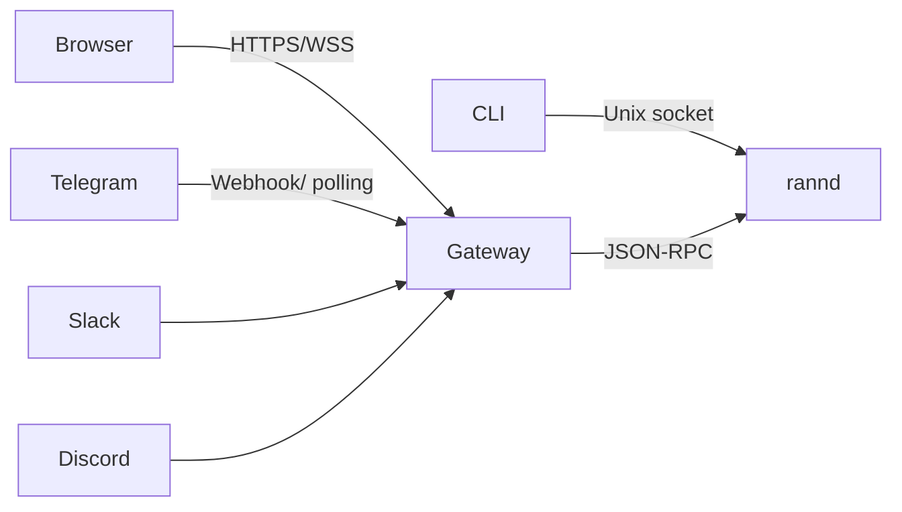

# 06. Git, Browser, Background Task, Scheduler, Gateway, Messaging, dan Dashboard

- Dokumen induk: MASTER.md
- Versi: 1.0
- Requirement: RC-FR-115 sampai RC-FR-136
- Acceptance criteria: RC-AC-115 sampai RC-AC-136

## 27. Git integration

### 27.1 Prinsip

Git adalah lapisan pemulihan, bukan alat dekorasi. Setiap perubahan agen harus bisa dibandingkan, dikembalikan, dan diaudit. Namun Rann Code tidak boleh mengubah riwayat pengguna tanpa izin.

Aturan:

- Tidak ada `git reset --hard`, `git clean -fd`, `git push --force`, atau penghapusan branch tanpa konfirmasi eksplisit.
- Commit yang dibuat agen diberi trailer `Rann-Code-Session: <id>` agar bisa dilacak.
- Agen tidak commit otomatis kecuali diminta atau dikonfigurasi.
- Jika working tree kotor saat task dimulai, agen mencatat diff awal dan tidak mencampurnya dengan perubahan sendiri tanpa memberi tahu.

### 27.2 Operasi baca

Tool: `git_status`, `git_diff`, `git_log`, `git_blame`, `git_branch_list`, `git_show`, `git_remote`.

Output dinormalisasi:

```json
{
  "branch": "feat/rate-limit",
  "ahead": 2,
  "behind": 0,
  "clean": false,
  "staged": [{"path": "src/http/chat.ts", "status": "M"}],
  "unstaged": [{"path": "test/chat.test.ts", "status": "M"}],
  "untracked": ["scripts/load-test.ts"]
}
```

Agen memakai status ini sebelum mengubah file. Jika file yang akan diubah sudah berubah sejak checkpoint, agen membaca ulang dan memberi tahu pengguna.

### 27.3 Checkpoint

Checkpoint dibuat tanpa mengubah commit pengguna:

- Jika repo bersih: buat commit sementara di ref `refs/rann/checkpoints/<task>/<n>` dengan pesan `checkpoint: <label>`.
- Jika repo kotor: snapshot file yang berubah ke blob store dan simpan diff terhadap HEAD.
- Jika bukan repo git: snapshot file yang berubah ke blob store.

Isi checkpoint:

```json
{
  "id": "ckpt_01J...",
  "taskId": "task_01J...",
  "sessionId": "ses_01J...",
  "createdAt": "2026-11-05T01:00:00Z",
  "kind": "git-ref",
  "ref": "refs/rann/checkpoints/task_01J/3",
  "baseCommit": "a1b2c3d",
  "files": ["src/http/chat.ts"],
  "label": "sebelum refactor middleware"
}
```

Restore:

- `git-ref`: checkout file dari ref ke working tree, tanpa mengubah HEAD.
- `blob`: tulis ulang file dari blob, verifikasi hash.
- Sebelum restore, buat checkpoint baru agar restore bisa dibatalkan.
- Restore tidak menghapus file yang dibuat setelah checkpoint kecuali `--clean` diberikan.

### 27.4 Worktree

Untuk task berisiko atau subagent paralel:

```
git worktree add .rann/worktrees/<task-id> -b rann/<task-id>
```

Aturan:

- Worktree berada di `.rann/worktrees/`, di-ignore git.
- Subagent bekerja di worktree sendiri, bukan di working tree utama.
- Setelah selesai, perubahan digabung lewat patch atau merge, bukan langsung.
- Worktree dihapus setelah task selesai atau gagal, kecuali `--keep`.
- Maksimal 4 worktree aktif default.

### 27.5 Commit

`/commit` atau tool `git_commit`:

1. Tampilkan staged dan unstaged.
2. Sarankan pesan commit berdasarkan diff, dalam format repo (Conventional Commits jika terdeteksi).
3. Minta persetujuan.
4. Commit dengan trailer.
5. Tampilkan hash dan ringkasan.

Agen tidak boleh meng-commit secret. Sebelum commit, jalankan pemindaian pola secret dan file yang tidak seharusnya masuk (`.env`, kunci, database lokal).

### 27.6 Push dan pull

Push:

- Tampilkan remote, branch, dan commit yang akan dikirim.
- Jika branch belum punya upstream, tanyakan.
- Jika remote menolak karena non-fast-forward, jangan force. Tawarkan rebase atau merge.
- Push ke `main` atau `master` memerlukan konfirmasi tambahan.

Pull:

- Jika working tree kotor, tawarkan stash checkpoint atau batalkan.
- Jika ada konflik, tampilkan file dan minta keputusan.
- Jangan menyelesaikan konflik secara otomatis tanpa menunjukkan diff.

### 27.7 Konflik

Deteksi konflik:

- File berubah sejak dibaca (hash berbeda).
- Patch tidak bisa diterapkan.
- Dua agen memegang lease yang sama.
- Merge menghasilkan konflik.

Resolusi:

1. Tampilkan versi dasar, versi agen, dan versi terkini.
2. Coba merge tiga arah untuk perubahan yang tidak tumpang tindih.
3. Jika tumpang tindih, eskalasi ke pengguna atau parent agent.
4. Jangan memilih salah satu versi secara diam-diam.

### 27.8 Rollback

`/undo` mengembalikan perubahan agen terakhir:

- Default: checkpoint terakhir.
- `--files <glob>`: hanya file yang cocok.
- `--to <checkpoint>`: kembali ke checkpoint tertentu.
- Sebelum rollback, buat checkpoint `before-undo`.
- Rollback dicatat di audit dan trace.

## 28. Browser automation

### 28.1 Pemisahan tiga jalur

| Jalur | Dipakai untuk | Tidak cocok untuk |
|---|---|---|
| Web search | Menemukan sumber, ringkasan | Halaman yang butuh login atau render JS berat |
| HTTP fetch | Mengambil HTML, JSON, PDF | Form, klik, login, interaksi |
| Browser | Halaman dinamis, login, form, screenshot | Pengambilan data massal sederhana |

Agen memilih jalur berdasarkan kebutuhan. Jika HTTP fetch cukup, browser tidak dijalankan. Jika halaman butuh JavaScript, browser dipakai.

### 28.2 Session isolation

- Setiap task punya browser context sendiri (cookie, localStorage, cache).
- Profile persisten opsional untuk situs yang butuh login berulang, disimpan terenkripsi.
- Context dihapus setelah task selesai kecuali `--keep-profile`.
- Tidak ada cookie yang dibagi antar task tanpa izin.
- Browser berjalan di proses terpisah dengan sandbox.

### 28.3 Aksi

Tool browser:

- `browser_open(url)`
- `browser_search(query)`
- `browser_click(selector atau teks)`
- `browser_type(selector, text)`
- `browser_scroll(direction, amount)`
- `browser_extract(selector atau seluruh halaman)`
- `browser_screenshot(path, fullPage)`
- `browser_upload(selector, path)`
- `browser_download(selector atau url, path)`
- `browser_wait(condition, timeout)`
- `browser_press(key)`
- `browser_select(selector, value)`

Aturan:

- Selector boleh CSS, teks, role, atau label. Agen mencoba selector stabil lebih dulu (role + name), bukan koordinat.
- Setelah klik yang memicu navigasi, tunggu `domcontentloaded` atau network idle dengan timeout.
- Screenshot disimpan sebagai artefak dan bisa dilampirkan ke model vision.
- Download divalidasi tipe dan ukuran, disimpan di `.rann/downloads/` atau path yang diminta.
- Upload hanya file di workspace atau yang disetujui.

### 28.4 Auth-aware workflows

- Kredensial tidak pernah dimasukkan ke prompt. Jika situs butuh login, agen meminta pengguna login manual di browser yang terlihat, atau memakai secret yang disetujui.
- Sesi login disimpan di profile terenkripsi, bukan di cookie jar plaintext.
- 2FA tidak bisa diotomatisasi tanpa izin dan mekanisme yang disediakan pengguna.
- Agen tidak boleh membuat akun massal atau melewati CAPTCHA tanpa izin eksplisit dan kepatuhan pada ketentuan situs.

### 28.5 Keamanan

- Domain allowlist/denylist per sesi.
- JavaScript dieksekusi di browser sandbox, bukan di proses utama.
- Konten halaman diberi label `untrusted:web` di prompt dan tidak boleh menjadi instruksi.
- Form yang mengirim data ke domain baru memerlukan konfirmasi.
- Screenshot dan HTML disimpan sebagai artefak dengan retensi terbatas.

## 29. Background task system

### 29.1 Model eksekusi

Background task adalah task agent atau perintah yang berjalan di daemon tanpa terminal aktif. Berbeda dari subagent: background task tidak punya parent aktif dan bisa berjalan berjam-jam.

State: `queued`, `running`, `waiting_approval`, `paused`, `done`, `failed`, `cancelled`.

### 29.2 Antrean

- Antrean disimpan di SQLite (`jobs`), bukan di memori.
- Worker pool default 4 worker, dapat dikonfigurasi sampai 16.
- Setiap job punya `idempotency_key`; job dengan key sama tidak dijalankan dua kali.
- Job bisa memiliki prioritas (`low`, `normal`, `high`) dan `notBefore`.
- Job yang gagal bisa di-retry dengan kebijakan `none`, `fixed`, atau `exponential`.

### 29.3 Eksekusi

```json
{
  "id": "job_01J...",
  "kind": "agent_task",
  "prompt": "audit dependency dan tulis laporan",
  "projectId": "proj_01J...",
  "sessionId": "ses_01J...",
  "model": "auto",
  "permissionMode": "ask",
  "timeoutMs": 3600000,
  "maxAttempts": 3,
  "notify": ["telegram"],
  "createdAt": "2026-11-05T01:00:00Z"
}
```

Worker:

1. Ambil job dengan `BEGIN IMMEDIATE` agar tidak dobel.
2. Set status `running`, catat worker id dan heartbeat.
3. Jalankan agent turn dengan budget job.
4. Simpan hasil, artefak, dan log.
5. Set status akhir.
6. Kirim notifikasi.

### 29.4 Monitoring dan pembatalan

`/background list` menampilkan id, status, durasi, dan progres. `/background logs` mengikuti log. `/background kill` mengirim sinyal batalkan, menunggu graceful timeout 10 detik, lalu mematikan process group.

Pembatalan:

- Agent menerima sinyal, menyimpan checkpoint, dan berhenti di batas langkah aman.
- Tool yang sedang berjalan dibatalkan.
- Status menjadi `cancelled`, bukan `failed`.
- Hasil parsial tetap disimpan.

### 29.5 Recovery

Saat daemon start:

1. Job `running` dengan heartbeat lebih dari 60 detik dianggap `stale`.
2. Job `stale` dikembalikan ke `queued` dengan `attempts + 1`, kecuali sudah mencapai max.
3. Checkpoint terakhir dimuat.
4. Tool yang statusnya `running` saat crash ditandai `unknown` dan tidak diulang otomatis kecuali idempoten.
5. Jika job tidak bisa dipulihkan, status `failed` dengan alasan `recovery_failed`.

### 29.6 Notifikasi

Kanal: terminal, desktop notification, Telegram, Discord, Slack, webhook.

Aturan:

- Kirim saat `done`, `failed`, `waiting_approval`, atau `cancelled`.
- Jangan kirim progres setiap langkah kecuali diminta.
- Gabungkan notifikasi dalam 60 detik untuk job yang sama.
- Sertakan id job, ringkasan, durasi, biaya, dan link ke sesi.
- Notifikasi tidak boleh memuat secret atau isi file sensitif.

### 29.7 Resource limits

- CPU dan memori per job bisa dibatasi lewat sandbox.
- Maksimal 8 job aktif default.
- Job yang melebihi batas memori dimatikan dengan status `resource_exhausted`.
- Job yang menghasilkan output lebih dari 100 MB dihentikan dan diberi peringatan.

## 30. Scheduler

### 30.1 Jenis jadwal

| Jenis | Contoh | Catatan |
|---|---|---|
| One-time | `2026-11-06T09:00:00+07:00` | Dijalankan sekali |
| Interval | `every 15m` | Berulang dari waktu mulai |
| Cron | `0 7 * * *` | Lima field, timezone IANA |
| Event | `on: task.failed` | Dipicu event internal |
| Conditional | `if: health.status != ok` | Dievaluasi sebelum run |

Cron memakai parser yang mendukung `*`, `,`, `-`, `/`, dan nama bulan/hari. Tidak mendukung `@reboot` karena daemon sudah menangani startup.

### 30.2 Timezone dan DST

- Setiap job menyimpan `timezone` IANA.
- Perhitungan next run memakai library timezone, bukan offset tetap.
- Saat DST mundur, job yang jatuh di jam yang sama tidak dijalankan dua kali; scheduler memilih occurrence pertama dan mencatat.
- Saat DST maju, job yang jatuh di jam yang tidak ada dijalankan pada jam berikutnya.
- Default timezone mengikuti config, lalu timezone sistem.

### 30.3 Eksekusi

- Scheduler berjalan di daemon dengan timer presisi 1 detik.
- Job yang jatuh tempo dimasukkan ke antrean background.
- Jika job sebelumnya masih berjalan, `overlap` policy: `skip` (default), `queue`, atau `cancel_previous`.
- Setiap run punya id, log, durasi, status, dan biaya.
- Retry mengikuti kebijakan job, bukan scheduler global.

### 30.4 Riwayat

`/scheduler logs <id>` menampilkan 50 run terakhir dengan status dan ringkasan. Dashboard menampilkan grafik durasi dan tingkat keberhasilan.

### 30.5 Keamanan

- Job yang menjalankan shell memerlukan permission `exec` dan tidak bisa dibuat oleh pengguna dengan role `viewer`.
- Job yang memakai secret harus merujuk secret id, bukan nilai literal.
- Perubahan jadwal dicatat di audit.
- Job dari plugin diberi namespace dan tidak bisa menimpa job inti.

## 31. Gateway

### 31.1 Posisi

Gateway adalah pintu masuk dari luar terminal: dashboard, web chat, Telegram, Discord, Slack, dan aplikasi lain. Gateway bukan agent. Ia mengautentikasi, merutekan, dan meneruskan event. Eksekusi tetap di daemon.



### 31.2 Mode deployment

| Mode | Bind | Auth | Dipakai untuk |
|---|---|---|---|
| Local | 127.0.0.1 | Token lokal | Dashboard di mesin yang sama |
| LAN | 0.0.0.0 | Pairing + TLS | Perangkat lain di jaringan tepercaya |
| Public | 0.0.0.0 di belakang reverse proxy | Pairing + TLS + rate limit | VPS |

Gateway menolak bind ke `0.0.0.0` tanpa `--public-url` dan tanpa auth. Tidak ada mode "terbuka".

### 31.3 API

- REST `/v1/*` untuk operasi.
- WebSocket `/v1/events` untuk streaming.
- JSON-RPC internal ke daemon.
- Semua response memakai envelope:

```json
{"ok": true, "data": {}, "meta": {"requestId": "req_...", "version": "1"}}
```

Error:

```json
{"ok": false, "error": {"code": "E_AUTH", "message": "...", "details": {}}, "meta": {"requestId": "req_..."}}
```

Endpoint minimum ada di ARCHITECTURE.md bagian API specifications.

### 31.4 Auth dan pairing

1. `rann pair --name laptop` membuat kode 8 karakter, berlaku 10 menit, sekali pakai.
2. Perangkat membuka `/pair`, memasukkan kode.
3. Gateway membuat token 32 byte, mengembalikan sekali, menyimpan hash Argon2id.
4. Token disimpan di perangkat (keychain atau file 0600).
5. Setiap request membawa `Authorization: Bearer <token>`.
6. Token punya scope: `read`, `run`, `approve`, `admin`, `gateway`.
7. Token bisa dicabut perangkat.

Pairing code tidak boleh dikirim lewat channel yang tidak aman. Untuk VPS, pairing dilakukan lewat SSH tunnel atau dashboard lokal, bukan chat publik.

### 31.5 Otorisasi

- Scope diperiksa per endpoint.
- `viewer`: read only.
- `operator`: read, run, approve task miliknya.
- `admin`: semua, termasuk config dan device.
- `owner`: satu per profil, tidak bisa dicabut lewat API.
- Resource-level check: pengguna hanya bisa mengakses sesi dan project yang diizinkan.

### 31.6 Session dan task routing

- Setiap koneksi punya `clientId`, `deviceId`, dan `sessionId`.
- Event dikirim ke klien yang berlangganan sesi.
- Jika klien reconnect, ia mengirim `lastEventId`; gateway mengirim event yang terlewat dari ring buffer 1.000 event atau dari database.
- Task remote dijalankan di daemon yang terhubung, bukan di gateway.
- Gateway bisa mengelola beberapa daemon (multi-node) dengan `nodeId`; routing berdasarkan project affinity.

### 31.7 Ketahanan

- Health endpoint `/v1/health` mengembalikan status gateway, daemon, database, dan provider.
- Reconnect WebSocket dengan backoff.
- Rate limit per token dan per IP.
- Timeout request default 30 detik, task long-running memakai WebSocket.
- Jika daemon mati, gateway mengembalikan 503 dengan kode `E_DAEMON_DOWN`, bukan menggantung.

## 32. Messaging integrations

### 32.1 Adapter interface

```ts
interface MessagingAdapter {
  id: "telegram" | "discord" | "slack" | "web";
  start(): Promise<void>;
  stop(): Promise<void>;
  send(message: OutgoingMessage): Promise<MessageRef>;
  edit(ref: MessageRef, message: OutgoingMessage): Promise<void>;
  onMessage(handler: (msg: IncomingMessage) => void): void;
  onAction(handler: (action: ActionEvent) => void): void;
}
```

`IncomingMessage` memuat platform, chat id, thread id, user id, text, attachments, dan reply reference. `OutgoingMessage` memuat text, format, buttons, attachments, dan reply reference.

### 32.2 Telegram

- Session key: `telegram:<chat_id>:<thread_id>` jika topik tersedia, else `telegram:<chat_id>`.
- Command `/new`, `/resume`, `/status`, `/cancel`, `/model` dipetakan ke command Rann Code.
- Pesan biasa menjadi prompt.
- Approval dikirim sebagai inline keyboard: Setujui, Tolak, Detail.
- File dikirim sebagai dokumen atau foto; batas ukuran mengikuti API Telegram.
- Pesan panjang dipecah pada batas aman, tanpa memotong code block.
- Update memakai long polling atau webhook; webhook memerlukan URL publik dan secret token.
- Grup: hanya pengguna yang diizinkan yang bisa memicu agent. Mention diperlukan jika `groupMode: mention`.

### 32.3 Discord

- Session key: `discord:<guild_id>:<channel_id>:<thread_id>`.
- Slash command untuk `/rann new`, `/rann status`, dan seterusnya.
- Thread dibuat otomatis untuk task panjang.
- Attachment dan embed didukung.
- Permission mengikuti role Discord yang dipetakan ke role Rann Code.

### 32.4 Slack

- Session key: `slack:<team_id>:<channel_id>:<thread_ts>`.
- Slash command, mention, dan threaded reply.
- Block Kit untuk approval.
- File upload lewat Slack files API.

### 32.5 Web chat

- Klien React di dashboard.
- Login memakai token perangkat atau SSO jika dikonfigurasi.
- Streaming lewat WebSocket.
- Riwayat dimuat dari database, bukan dari memori browser.

### 32.6 Multi-user dan akses

- Setiap pengguna messaging dipetakan ke `user_id` Rann Code.
- Pengguna tak dikenal ditolak dengan pesan yang tidak membocorkan konfigurasi.
- DM pairing: kode sekali pakai untuk menautkan akun messaging ke profil.
- Role default untuk pengguna baru: `viewer`, kecuali diundang sebagai `operator`.
- Semua aksi sensitif dari messaging tetap memerlukan approval di kanal yang sama atau dashboard.

### 32.7 Attachment

- Unduh ke `~/.rann/state/attachments/<id>`.
- Validasi tipe MIME dan ukuran (maksimal 50 MB default).
- Nama file disanitasi.
- File tidak dieksekusi.
- Referensi ke prompt memakai path dan metadata, bukan isi biner.

## 33. Web dashboard

### 33.1 Prinsip

Dashboard adalah klien dari API yang sama dengan CLI. Tidak ada database kedua, tidak ada state yang hanya ada di browser. Jika dashboard mati, CLI tetap bekerja. Jika CLI mati, dashboard tetap bisa membaca state dari daemon.

### 33.2 Halaman

| Halaman | Isi |
|---|---|
| Overview | Health, sesi aktif, task berjalan, biaya hari ini, error terbaru |
| Sessions | Daftar sesi, filter project, buka transcript, kirim pesan |
| Tasks | Antrean, status, log, cancel, retry |
| Agents | Pohon agen, status, budget, transcript |
| Models | Registry, provider health, routing policy, test model |
| Providers | Konfigurasi, tes koneksi, usage |
| Skills | Daftar, detail, versi, install, enable |
| Memory | Cari, filter, edit, pin, hapus, riwayat |
| Tools | Daftar, schema, enable, log |
| MCP | Server, status, tools, auth, log |
| Plugins | Terpasang, permission, update |
| Hooks | Event, matcher, test |
| Scheduler | Job, riwayat, run now |
| Gateway | Status, device, token, pairing |
| Analytics | Token, biaya, model, task success rate |
| Logs | Filter, follow, trace id |
| Settings | Config, permission, theme, retention |

### 33.3 Realtime

- WebSocket `/v1/events` mengirim event yang sama dengan CLI.
- Dashboard memakai query cache dengan invalidasi berdasarkan event.
- Jika WebSocket putus, dashboard fallback ke polling 5 detik dan menampilkan status `reconnecting`.
- Tidak ada optimistic update untuk aksi berbahaya (approval, delete, config) sampai server mengonfirmasi.

### 33.4 Otorisasi UI

- Menu dan tombol disembunyikan sesuai scope, tetapi server tetap memeriksa.
- Aksi yang ditolak menampilkan alasan, bukan error generik.
- Perubahan config menampilkan diff dan meminta konfirmasi.
- Secret tidak pernah dikirim ke browser, hanya status `set` atau `not set`.

### 33.5 Aksesibilitas

- Navigasi keyboard penuh.
- Fokus terlihat.
- Kontras minimal 4,5:1.
- Tabel bisa dibaca screen reader.
- Tidak ada animasi yang tidak bisa dimatikan.

### 33.6 Teknologi

React 19, Vite, TanStack Query, React Router, Radix UI primitives, dan CSS token yang sama dengan tema CLI. Tidak memakai framework yang mengunci SSR karena dashboard adalah aplikasi internal yang dilayani gateway. Build statis disajikan oleh gateway.
