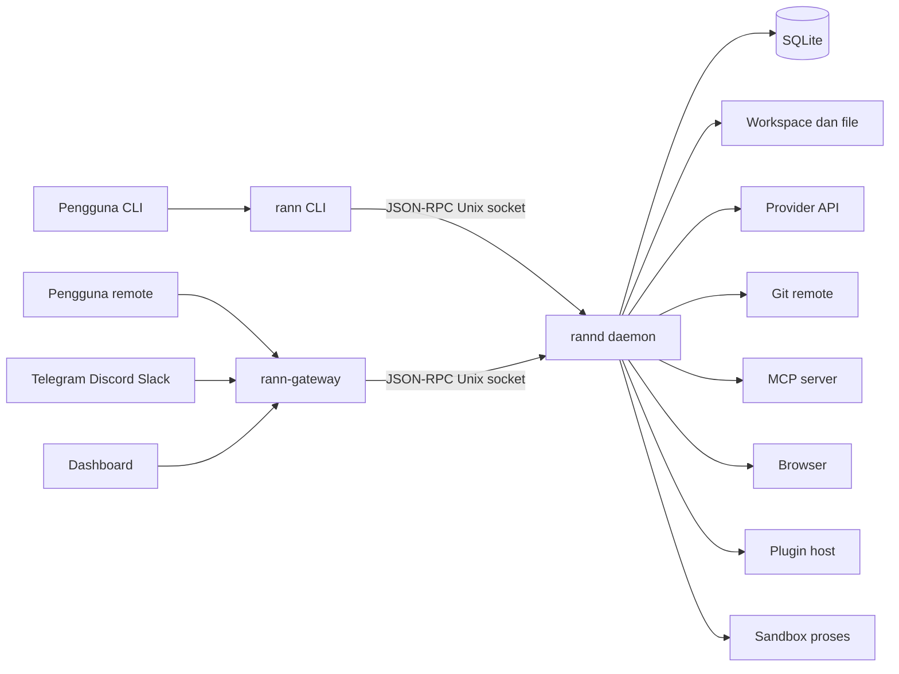
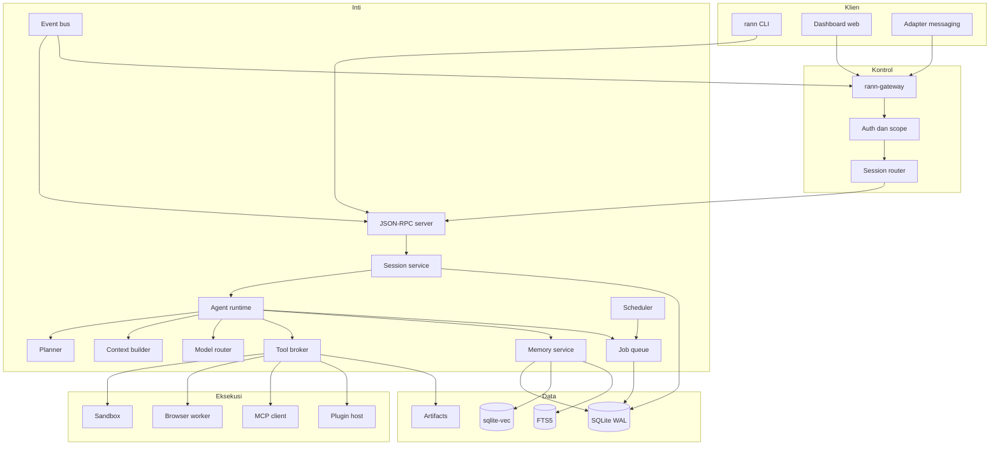
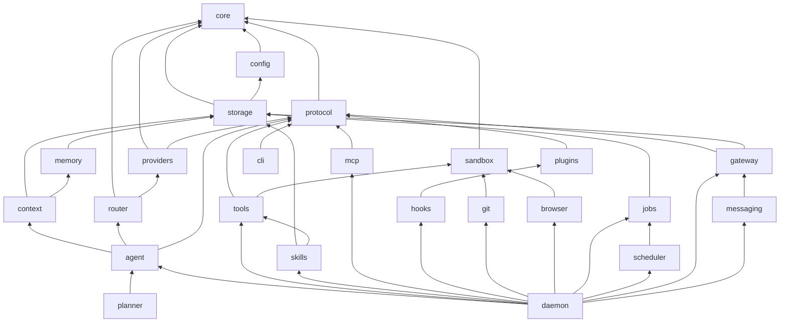
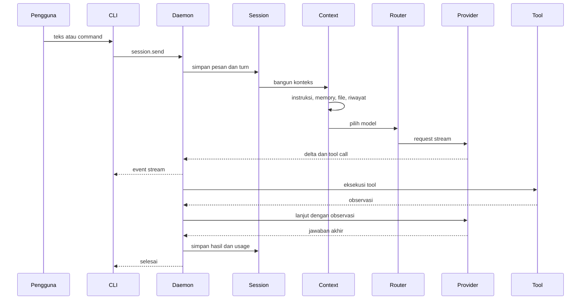
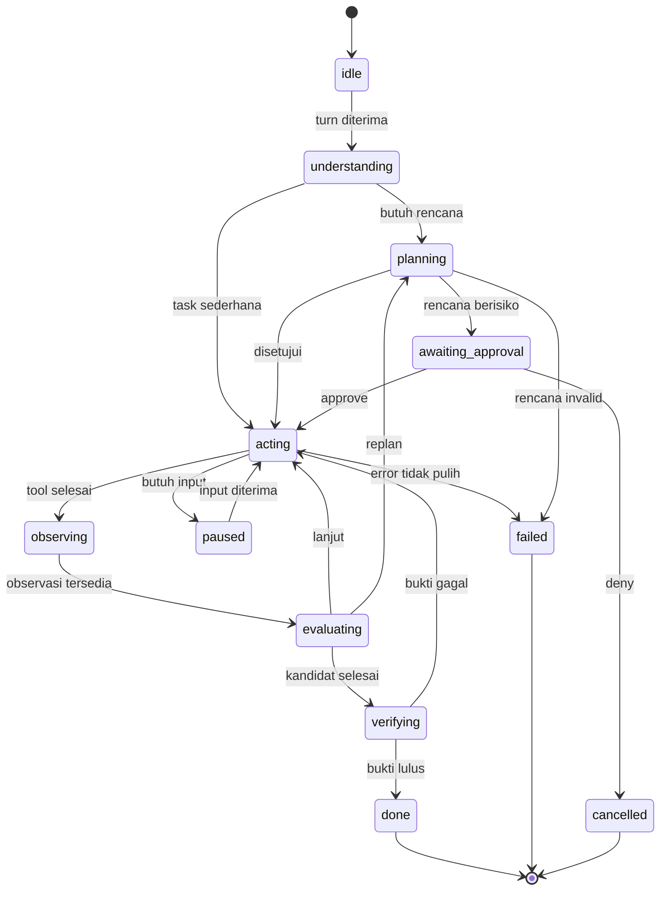
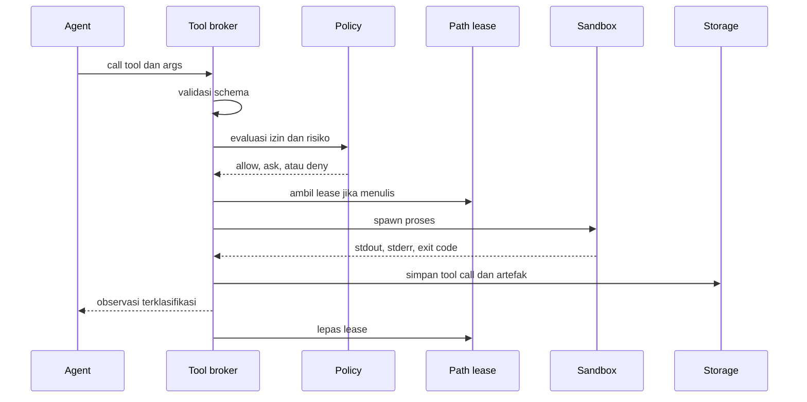
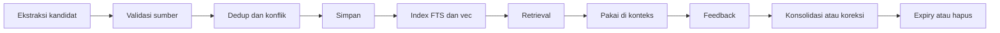
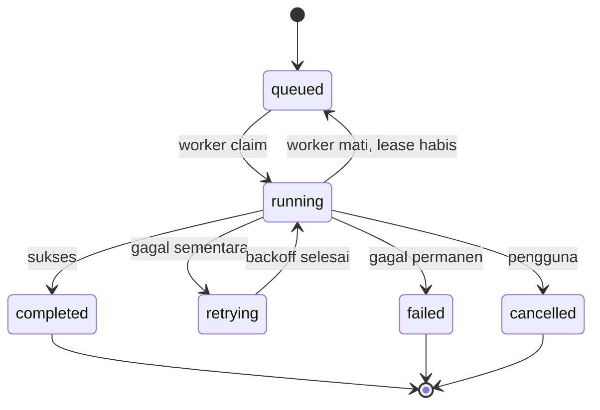
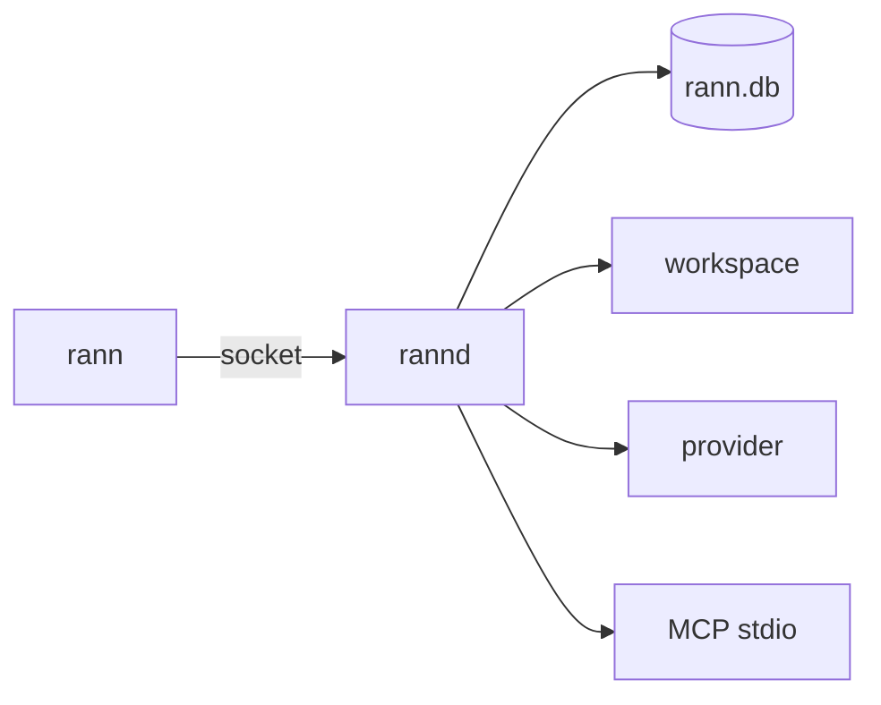
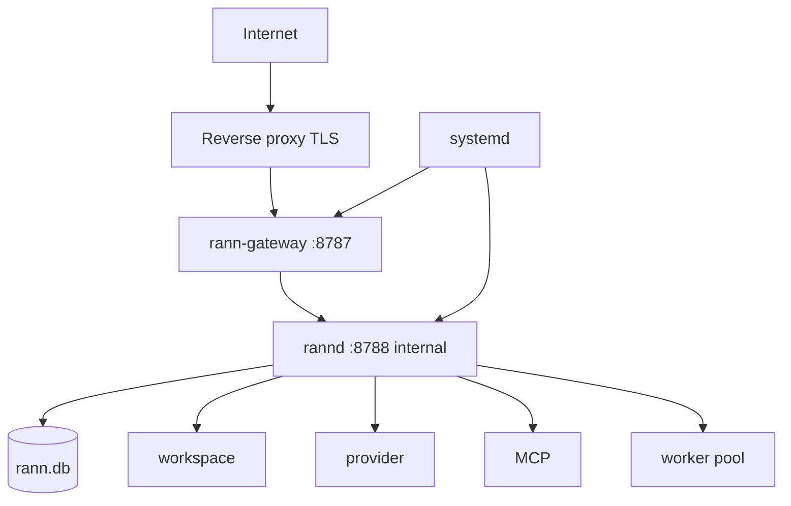

# ARCHITECTURE. Sistem, Modul, Data, dan API

- Dokumen induk: MASTER.md
- Versi: 1.0
- Requirement terkait: RC-FR-001 sampai RC-FR-151, RC-NFR-001 sampai RC-NFR-024
- Prinsip: local-first, daemon persisten, batas modul tegas, keamanan di runtime.

## 1. Architectural drivers

| Driver | Arti | Konsekuensi arsitektur |
|---|---|---|
| Local-first | Data dan state utama ada di mesin pengguna | SQLite, file, tanpa akun wajib, tanpa telemetry |
| Long-running | Task bertahan saat terminal ditutup atau daemon restart | Daemon terpisah, checkpoint, job queue persisten |
| Multi-client | CLI, dashboard, messaging melihat state yang sama | Satu API, satu database, event fan-out |
| Multi-provider | Tidak terikat satu vendor | Adapter wire protocol + capability registry |
| Aman secara default | Izin dan sandbox bukan opsional | Policy engine, approval, isolasi proses |
| Dapat diaudit | Setiap aksi penting bisa ditelusuri | Audit hash chain, tool call log, usage |
| Dapat diuji tanpa model | CI tidak bergantung API eksternal | Provider mock, clock dan ID deterministik |

Driver ini mengalahkan pertimbangan lain. Jika sebuah desain mempermudah satu driver tetapi merusak driver lain, desain ditolak.

## 2. System context

Aktor dan sistem luar:

- Pengguna lokal lewat terminal.
- Pengguna remote lewat dashboard, Telegram, Discord, Slack, atau web chat.
- Provider model lewat HTTPS.
- Git remote lewat SSH atau HTTPS.
- MCP server lokal atau remote.
- Registry plugin dan skill.
- Browser target untuk automasi.
- Sistem operasi: filesystem, process, socket, keychain.



Batas kepercayaan:

| Zona | Isi | Kepercayaan |
|---|---|---|
| Zona 1 | Proses CLI dan pengguna lokal | Tepercaya, tetapi tetap melewati policy |
| Zona 2 | Daemon dan database | Tepercaya, dijaga permission OS |
| Zona 3 | Gateway dan klien remote | Tidak tepercaya sampai token dan scope valid |
| Zona 4 | Tool output, web, file, MCP, plugin | Tidak tepercaya, selalu dilabeli |
| Zona 5 | Provider model | Eksternal, menerima data sesuai izin pengguna |

## 3. High-level architecture

Proses utama:

| Proses | Tanggung jawab | State |
|---|---|---|
| `rann` | Render TUI, input, stream, command | Tidak menyimpan state bisnis |
| `rannd` | Agent runtime, tool broker, storage, scheduler, event bus | Sumber kebenaran |
| `rann-gateway` | REST, WebSocket, auth, adapter messaging | Token dan koneksi |
| Dashboard | SPA statis yang memanggil gateway | Tidak ada state bisnis |
| Worker | Menjalankan job dan tool berat | Checkpoint di database |
| Plugin host | Menjalankan satu plugin | State plugin |
| Sandbox | Menjalankan satu perintah atau tool | Ephemeral |



Mode deployment:

1. Lokal: CLI + daemon, Unix socket, tanpa port jaringan.
2. VPS: daemon di localhost, gateway di belakang reverse proxy TLS.
3. Container: satu image, volume `~/.rann` dan workspace.
4. Multi-node: beberapa daemon dengan database masing-masing, gateway merutekan berdasarkan project.

## 4. Component architecture dan batas modul

Package workspace:

| Package | Tanggung jawab | Boleh bergantung pada | Dilarang |
|---|---|---|---|
| `@rann/core` | Tipe, error, result, clock, ID, event | stdlib | I/O, provider, storage |
| `@rann/protocol` | Skema JSON-RPC, REST, event, validasi | core, zod | storage, agent |
| `@rann/config` | Schema config, hierarki, migrasi | core | agent, provider |
| `@rann/storage` | SQLite, migrasi, repository, FTS, vec | core, config | provider, agent |
| `@rann/providers` | Adapter wire protocol | core, protocol | storage, tools |
| `@rann/router` | Pemilihan model dan fallback | core, providers | tools, CLI |
| `@rann/context` | Perakitan konteks, token budget, compaction | core, storage, memory | provider konkret |
| `@rann/memory` | Ekstraksi, retrieval, dedup, decay | core, storage | agent |
| `@rann/agent` | Loop, state machine, verifier | core, protocol, context, router | CLI, gateway |
| `@rann/planner` | Task graph, estimasi, replanning | core, agent | storage |
| `@rann/tools` | Registry, schema, eksekusi | core, protocol, sandbox | CLI |
| `@rann/sandbox` | Proses terisolasi, path, env, timeout | core | agent, storage |
| `@rann/skills` | Discovery, validasi, loading | core, storage, tools | agent |
| `@rann/mcp` | Client MCP, transport, discovery | core, protocol | agent |
| `@rann/plugins` | Manifest, host, permission | core, protocol | agent |
| `@rann/hooks` | Registry dan eksekusi hook | core, plugins | agent |
| `@rann/git` | Operasi Git dan checkpoint | core, sandbox | agent |
| `@rann/browser` | Automasi browser | core, sandbox | agent |
| `@rann/jobs` | Queue, worker, heartbeat, recovery | core, storage | agent |
| `@rann/scheduler` | Cron, interval, trigger | core, jobs | agent |
| `@rann/gateway` | REST, WS, auth, routing | core, protocol, storage | agent |
| `@rann/messaging` | Adapter platform | core, gateway | agent |
| `@rann/cli` | TUI, command, render | core, protocol | storage, provider |
| `@rann/daemon` | Komposisi semua service | semua kecuali CLI | CLI |
| `@rann/dashboard` | SPA | protocol | storage |
| `@rann/testkit` | Mock provider, fixture, harness | core, protocol | produksi |

Aturan batas:

1. `core` tidak mengimpor package lain.
2. `storage` tidak tahu provider atau agent.
3. `agent` tidak mengimpor adapter provider konkret; ia memakai interface.
4. `tools` tidak mengimpor agent; tool menerima context dan mengembalikan hasil.
5. `cli` tidak membuka database dan tidak memanggil provider.
6. `gateway` tidak menjalankan agent secara langsung; ia memanggil daemon.
7. Package baru harus punya README, pemilik, dan tes.
8. Dependency melingkar menggagalkan build.

## 5. Dependency graph



Urutan build Turborepo mengikuti graf di atas. `core` selalu pertama, `daemon` terakhir.

## 6. Data flow

### 6.1 Prompt masuk



### 6.2 Data yang disimpan dan tidak

| Data | Disimpan | Umur default | Catatan |
|---|---|---|---|
| Pesan dan turn | Ya | 90 hari | Bisa dihapus pengguna |
| Tool call dan hasil | Ya | 90 hari | Output besar dipotong, blob di artefak |
| Prompt sistem | Tidak penuh | n/a | Hanya hash dan versi |
| Secret | Vault | Sampai dihapus | Tidak pernah di log |
| Embedding | Ya | Mengikuti memory | Dihapus bersama sumber |
| Audit | Ya | 1 tahun | Hash chain |
| Stream delta | Tidak | n/a | Hanya hasil akhir |
| File workspace | Tidak | n/a | Milik pengguna |

### 6.3 Klasifikasi data

- Publik: nama model, versi, status.
- Project: isi file, riwayat Git, konteks.
- Sensitif: secret, token, isi `.env`, data pribadi.
- Audit: metadata aksi, bukan isi sensitif.

Data sensitif tidak boleh masuk prompt kecuali diminta eksplisit dan melewati redaksi.

## 7. Lifecycle

### 7.1 Agent execution lifecycle

State:



Invariant:

1. Tidak ada transisi ke `done` tanpa verifier.
2. Tidak ada transisi ke `acting` untuk tool tulis tanpa policy check.
3. Goal tidak berubah kecuali pengguna mengubahnya.
4. Setiap transisi ditulis ke event dan checkpoint.
5. Budget habis memaksa `paused` atau `failed`, bukan diam-diam lanjut.

### 7.2 Tool execution lifecycle



Aturan:

- Argumen invalid tidak pernah sampai ke sandbox.
- Timeout membunuh process group.
- Output > 1 MB dipotong dan disimpan sebagai artefak.
- Exit code dan sinyal dipetakan ke kategori.
- Setiap tool call punya `toolCallId` dan audit entry.
- Tool yang menulis file wajib punya lease.
- Tool yang mengubah Git wajib membuat checkpoint.

### 7.3 Session lifecycle

State: `created`, `active`, `compacting`, `paused`, `archived`, `deleted`.

- `created` sampai pesan pertama.
- `active` saat turn berjalan atau siap.
- `compacting` saat context compaction; input ditahan.
- `paused` saat butuh approval atau input.
- `archived` setelah tidak aktif; masih bisa dibaca.
- `deleted` soft delete 30 hari, lalu purge.

Resume memuat checkpoint terakhir, bukan mengulang tool yang sudah selesai.

### 7.4 Memory lifecycle



Aturan:

- Kandidat tanpa `source_session_id` atau `source_path` ditolak.
- Konflik memakai `updated_at` dan skor keyakinan; yang kalah disimpan sebagai riwayat.
- Retrieval memfilter lingkup dan budget sebelum ranking.
- Memory yang sering dipakai naik prioritas; yang tidak pernah dipakai meluruh.
- Penghapusan mempertahankan audit metadata.

### 7.5 Gateway lifecycle

State: `starting`, `ready`, `degraded`, `draining`, `stopped`.

- `starting`: validasi config, buka port, cek daemon.
- `ready`: menerima koneksi.
- `degraded`: daemon atau database bermasalah; health melaporkan.
- `draining`: tidak menerima koneksi baru, menyelesaikan yang berjalan.
- `stopped`: semua koneksi ditutup.

Reconnect WebSocket memakai `Last-Event-ID` dan buffer event 10 menit.

### 7.6 Background job lifecycle



Job diakui hanya setelah transaksi commit. Worker menulis heartbeat setiap 15 detik. Lease 60 detik. Job yang lease-nya habis dikembalikan ke antrean dengan `attempt + 1`.

### 7.7 Scheduler lifecycle

Tick setiap 30 detik. Job yang jatuh tempo dimaterialisasi menjadi job run dengan `scheduled_for`. Misfire policy: `skip`, `run_once`, atau `catch_up`, default `run_once`. Timezone disimpan di job, bukan di server.

### 7.8 Subagent lifecycle

Spawn -> inherit context -> run -> report -> merge -> cleanup.

- Subagent menerima salinan konteks yang relevan, bukan seluruh transcript.
- Subagent tidak bisa spawn lebih dalam dari batas.
- Hasil dikembalikan sebagai laporan dan artefak.
- File yang diubah melalui merge queue, bukan langsung.
- Subagent yang gagal tidak menjatuhkan parent.

## 8. Reliability dan error recovery architecture

### 8.1 Failure domain

| Domain | Contoh | Deteksi | Pemulihan |
|---|---|---|---|
| Provider | timeout, 429, 500, stream putus | error adapter, heartbeat | retry, fallback, pause |
| Tool | crash, timeout, output invalid | exit code, schema | retry atau laporkan |
| Database | lock, korup, disk penuh | integrity check, error SQLite | backup, restore, read-only |
| Daemon | crash, OOM, kill | supervisor, heartbeat | restart, resume checkpoint |
| Gateway | disconnect, overload | health, heartbeat | reconnect, backpressure |
| Scheduler | misfire, clock skew | tick, timestamp | misfire policy |
| Plugin | crash, hang | exit code, timeout | restart atau disable |
| MCP | disconnect, handshake gagal | ping, timeout | reconnect, disable server |

### 8.2 Prinsip

1. Setiap operasi tulis punya idempotency key.
2. Setiap perubahan state dan event ditulis dalam transaksi yang sama bila memungkinkan.
3. Event keluar memakai outbox agar tidak hilang.
4. Worker memakai lease, bukan lock abadi.
5. Retry hanya untuk error yang aman diulang.
6. Kegagalan yang tidak diketahui dianggap permanen sampai dianalisis.
7. Tidak ada retry tanpa batas.
8. Setiap pemulihan dicatat di audit.

### 8.3 Recovery matrix

| Kejadian | Data | Tindakan |
|---|---|---|
| Daemon mati saat menunggu provider | Pesan tersimpan, turn `running` | Tandai `interrupted`, lanjutkan dari checkpoint |
| Daemon mati saat tool berjalan | Tool call `running` | Cek efek samping, jalankan ulang hanya jika idempoten |
| Worker mati | Job `running` dengan lease | Kembalikan ke antrean setelah lease habis |
| Database korup | Backup terakhir | Restore, verifikasi, laporkan kehilangan |
| Gateway mati | Event buffer | Klien reconnect, replay dari `Last-Event-ID` |
| Disk penuh | Tulis gagal | Hentikan job baru, bersihkan cache, beri peringatan |
| Clock mundur | Jadwal dan expiry | Pakai monotonic clock untuk durasi, wall clock untuk jadwal |

### 8.4 Graceful shutdown

Urutan:

1. Berhenti menerima request baru.
2. Hentikan scheduler tick.
3. Selesaikan turn yang sedang berjalan maksimal 5 detik.
4. Simpan checkpoint.
5. Lepas lease.
6. Tutup koneksi database.
7. Keluar dengan kode 0.

Jika waktu habis, proses anak dimatikan dan state ditandai `interrupted`.

## 9. Storage architecture

### 9.1 Prinsip

- Satu database SQLite per profil di `~/.rann/profiles/<id>/rann.db`.
- WAL, `synchronous=NORMAL`, `foreign_keys=ON`, `busy_timeout=5000`.
- Satu writer melalui antrean internal.
- File besar di `artifacts/`, bukan blob di database.
- FTS5 untuk teks, sqlite-vec untuk embedding.
- Backup memakai `VACUUM INTO`.
- Migrasi versioned dan checksum.

### 9.2 Directory structure

```
~/.rann/
├── config/
│   ├── config.toml
│   ├── permissions.toml
│   └── mcp.toml
├── profiles/
│   └── default/
│       ├── rann.db
│       ├── rann.db-wal
│       ├── artifacts/
│       ├── checkpoints/
│       ├── logs/
│       └── backups/
├── providers/
│   └── <provider>.toml
├── models/
│   └── registry.toml
├── memory/
│   └── exports/
├── skills/
│   ├── <nama>/SKILL.md
│   └── registry.json
├── agents/
│   └── <nama>.md
├── plugins/
│   └── <nama>/
├── tools/
│   └── <nama>.toml
├── sessions/
├── tasks/
├── scheduler/
├── gateway/
│   ├── devices.json
│   └── tls/
├── logs/
├── cache/
└── run/
    ├── daemon.sock
    └── daemon.pid
```

Project:

```
project/
├── RANN.md
├── AGENTS.md
├── CLAUDE.md
├── .rann/
│   ├── config.toml
│   ├── permissions.toml
│   ├── agents/
│   ├── skills/
│   └── commands/
└── .gitignore
```

Permission direktori `~/.rann` adalah 0700, file sensitif 0600.

### 9.3 Database schema

36 tabel. Semua tabel punya `id TEXT PRIMARY KEY`, `created_at INTEGER`, dan `updated_at INTEGER` kecuali tabel append-only.

| Tabel | Fungsi | Kolom kunci | Indeks |
|---|---|---|---|
| `schema_migrations` | Versi migrasi | `version`, `checksum`, `applied_at` | PK `version` |
| `profiles` | Profil pengguna | `name`, `locale`, `settings_json` | unique `name` |
| `projects` | Project terdaftar | `path`, `name`, `git_remote`, `default_branch` | unique `path` |
| `sessions` | Sesi | `profile_id`, `project_id`, `title`, `status`, `model`, `permission_mode`, `parent_id` | `(project_id, status)`, `updated_at` |
| `turns` | Satu giliran | `session_id`, `status`, `started_at`, `ended_at`, `usage_json`, `error_code` | `(session_id, created_at)` |
| `messages` | Pesan | `session_id`, `turn_id`, `role`, `content`, `content_json`, `token_count` | `(session_id, created_at)` |
| `tool_calls` | Eksekusi tool | `turn_id`, `tool_name`, `args_json`, `result_json`, `status`, `exit_code`, `duration_ms` | `(turn_id)`, `(tool_name, created_at)` |
| `tasks` | Task agent | `session_id`, `parent_id`, `title`, `goal`, `status`, `priority`, `assigned_agent_id` | `(session_id, status)` |
| `task_steps` | Langkah task | `task_id`, `seq`, `description`, `status`, `result_json` | `(task_id, seq)` |
| `plans` | Rencana | `session_id`, `version`, `status`, `summary`, `approved_by` | `(session_id, version)` |
| `plan_nodes` | Node DAG | `plan_id`, `task_id`, `depends_on_json`, `estimate_min`, `risk` | `(plan_id)` |
| `agents` | Profil agen | `name`, `kind`, `model`, `prompt_path`, `tools_json`, `permission_mode` | unique `name` |
| `agent_runs` | Instans agen | `agent_id`, `session_id`, `parent_run_id`, `status`, `budget_json`, `started_at`, `ended_at` | `(session_id, status)` |
| `agent_messages` | Pesan antar agen | `from_run_id`, `to_run_id`, `kind`, `content` | `(to_run_id, created_at)` |
| `memory_entries` | Memory | `profile_id`, `scope`, `project_id`, `session_id`, `kind`, `content`, `confidence`, `source_json`, `expires_at` | `(profile_id, scope, kind)`, `expires_at` |
| `memory_links` | Relasi memory | `from_id`, `to_id`, `relation` | `(from_id)`, `(to_id)` |
| `memory_events` | Riwayat memory | `memory_id`, `action`, `before_json`, `after_json`, `actor` | `(memory_id, created_at)` |
| `skills` | Skill | `name`, `scope`, `path`, `version`, `enabled`, `metadata_json` | unique `(scope, name)` |
| `skill_versions` | Versi skill | `skill_id`, `version`, `hash`, `content_path`, `changelog` | `(skill_id, version)` |
| `tools` | Tool kustom | `name`, `kind`, `schema_json`, `handler`, `enabled` | unique `name` |
| `mcp_servers` | Server MCP | `name`, `transport`, `command`, `url`, `env_json`, `status` | unique `name` |
| `plugins` | Plugin | `name`, `version`, `path`, `manifest_json`, `status`, `granted_permissions_json` | unique `name` |
| `hooks` | Hook | `event`, `matcher`, `command`, `timeout_ms`, `enabled` | `(event)` |
| `providers` | Provider | `name`, `kind`, `base_url`, `auth_ref`, `enabled` | unique `name` |
| `models` | Model | `provider_id`, `model_id`, `display_name`, `context_window`, `max_output`, `input_price`, `output_price`, `enabled` | unique `(provider_id, model_id)` |
| `model_capabilities` | Capability | `model_id`, `capability`, `value_json` | `(model_id, capability)` |
| `routing_logs` | Keputusan router | `turn_id`, `chosen_model`, `reason`, `candidates_json`, `cost_estimate` | `(turn_id)`, `created_at` |
| `scheduler_jobs` | Job terjadwal | `name`, `schedule`, `timezone`, `payload_json`, `misfire_policy`, `enabled`, `next_run_at` | `(enabled, next_run_at)` |
| `job_runs` | Eksekusi job | `job_id`, `status`, `attempt`, `scheduled_for`, `started_at`, `ended_at`, `error` | `(job_id, started_at)`, `(status)` |
| `checkpoints` | Checkpoint task | `session_id`, `turn_id`, `task_id`, `state_json`, `git_ref`, `seq` | `(session_id, seq)` |
| `artifacts` | File hasil | `session_id`, `turn_id`, `kind`, `path`, `mime`, `size`, `sha256` | `(session_id)`, `sha256` |
| `audit_log` | Audit | `actor`, `action`, `resource`, `decision`, `metadata_json`, `prev_hash`, `hash` | `created_at`, `(resource)` |
| `usage_events` | Usage dan biaya | `provider`, `model`, `session_id`, `turn_id`, `input_tokens`, `output_tokens`, `cost_usd` | `(session_id)`, `(provider, created_at)` |
| `config_kv` | Config runtime | `key`, `value_json`, `scope`, `scope_id`, `updated_by` | unique `(key, scope, scope_id)` |
| `events` | Outbox event | `type`, `payload_json`, `published_at`, `seq` | `(published_at)`, `seq` |
| `path_leases` | Lease file | `path`, `owner_run_id`, `session_id`, `expires_at` | unique `path`, `expires_at` |
| `approvals` | Permintaan izin | `session_id`, `turn_id`, `tool_call_id`, `risk`, `status`, `decided_by`, `reason` | `(session_id, status)` |

Aturan skema:

1. Foreign key wajib dengan `ON DELETE` yang sesuai.
2. Waktu disimpan sebagai epoch milidetik UTC.
3. JSON divalidasi sebelum disimpan.
4. Hash file artefak SHA-256.
5. Audit append-only; tidak ada `UPDATE` atau `DELETE` dari aplikasi.
6. `events` dipangkas setelah 7 hari.
7. `path_leases` dibersihkan saat start.

### 9.4 FTS dan vektor

- `memory_fts` memakai FTS5 dengan `content='memory_entries'`.
- `message_fts` opsional untuk pencarian transcript.
- `memory_vec` memakai sqlite-vec dengan dimensi per model embedding.
- Dimensi berbeda disimpan di tabel terpisah atau kolom `dim`.
- Saat memory dihapus, FTS dan vec dihapus dalam transaksi yang sama.
- Reindex tersedia lewat `/doctor --reindex`.

### 9.5 Backup, migrasi, dan retensi

- Backup otomatis sebelum migrasi.
- Backup harian jika diaktifkan, disimpan 7 hari.
- `VACUUM INTO` menghasilkan file konsisten.
- Restore memverifikasi `integrity_check` dan `foreign_key_check`.
- Migrasi yang gagal me-restore backup dan mencatat error.
- Retensi mengikuti RC-NFR-014.
- Purge memakai batch agar tidak mengunci database.

## 10. Configuration architecture

### 10.1 Hierarki

| Lapis | Lokasi | Menang atas |
|---|---|---|
| Default | kode | tidak ada |
| Global | `~/.rann/config/config.toml` | default |
| Profil | `~/.rann/profiles/<id>/config.toml` | global |
| Project | `<project>/.rann/config.toml` | profil |
| Environment | `RANN_*` | project |
| Flag CLI | argumen | environment |
| Sesi | nilai saat sesi dibuat | flag untuk sesi itu |

Nilai yang lebih spesifik menang. Untuk array, default diganti, bukan digabung, kecuali dinyatakan `merge = true`.

### 10.2 Format

- TOML untuk config manusia.
- JSON untuk state mesin.
- YAML hanya untuk plugin manifest yang membutuhkannya.
- Skema Zod menjadi sumber kebenaran; dokumentasi dihasilkan dari skema.

### 10.3 Environment variables

| Variabel | Fungsi |
|---|---|
| `RANN_HOME` | Lokasi direktori data |
| `RANN_PROFILE` | Profil aktif |
| `RANN_CONFIG` | Path config tambahan |
| `RANN_LOG_LEVEL` | Level log |
| `RANN_NO_COLOR` | Matikan warna |
| `RANN_GATEWAY_TOKEN` | Token gateway untuk CI |
| `RANN_PROVIDER_<NAME>_KEY` | API key provider |

Secret tidak disarankan lewat env untuk penggunaan jangka panjang; env hanya untuk CI.

### 10.4 Validasi dan reload

- Config divalidasi saat start dan setiap reload.
- Field invalid memakai default dan menghasilkan peringatan.
- Reload panas hanya untuk field yang aman: tema, log level, model default.
- Perubahan provider, gateway, dan sandbox butuh restart.
- `/config explain <key>` menampilkan nilai efektif dan asal.

### 10.5 Instruction files

Urutan prioritas, dari rendah ke tinggi:

1. `~/.rann/SOUL.md` (identitas dan gaya global).
2. `~/.rann/USER.md` (profil dan preferensi pengguna).
3. `~/.rann/MEMORY.md` (catatan jangka panjang, dengan budget).
4. `~/.rann/RANN.md` (aturan global).
5. `~/.rann/AGENTS.md` (perilaku agen global).
6. `<project>/RANN.md`.
7. `<project>/AGENTS.md`.
8. `<project>/CLAUDE.md` (kompatibilitas).
9. `<project>/.rann/instructions.md` dan `.rann/rules/*.md`.
10. Instruksi agen spesifik dari `~/.rann/agents/<nama>.md` atau `.rann/agents/`.
11. Instruksi sesi dari pengguna.

Aturan:

- File yang lebih spesifik menang jika konflik.
- Konflik eksplisit dilaporkan di `/context`.
- Instruksi tidak bisa menaikkan permission.
- Instruksi dari file tidak tepercaya tidak mengalahkan kebijakan runtime.
- Ukuran total dibatasi budget konteks; file besar diringkas dengan label.
- `SOUL.md`, `USER.md`, dan `MEMORY.md` tidak bisa menaikkan permission atau mematikan audit.
- `MEMORY.md` tidak dimuat seluruhnya; entri dipilih berdasarkan relevansi dan tetap melewati redaksi secret.
- File instruksi project tidak boleh berasal dari symlink di luar workspace.

### 10.6 Migrasi config

- Setiap perubahan skema punya migrasi.
- Sebelum migrasi, config dicopy ke `backups/config-<timestamp>.toml`.
- Field yang dihapus dicatat di changelog migrasi.
- Config yang tidak bisa dimigrasikan menghasilkan error yang menyebut file dan baris.

## 11. API specifications

### 11.1 JSON-RPC internal (CLI dan gateway ke daemon)

Transport: Unix socket, NDJSON, satu request per baris. Versi protokol `1`.

Request:

```json
{"jsonrpc":"2.0","id":"req_01J...","method":"session.send","params":{"sessionId":"ses_01J...","text":"halo"}}
```

Response sukses:

```json
{"jsonrpc":"2.0","id":"req_01J...","result":{"turnId":"turn_01J..."}}
```

Response error:

```json
{"jsonrpc":"2.0","id":"req_01J...","error":{"code":"E_SESSION_NOT_FOUND","message":"Sesi tidak ditemukan","data":{"sessionId":"ses_..."}}}
```

Notifikasi event (tanpa id):

```json
{"jsonrpc":"2.0","method":"event","params":{"type":"message.delta","sessionId":"ses_...","turnId":"turn_...","data":{"text":"Ha"}}}
```

Metode minimum:

| Method | Params | Hasil |
|---|---|---|
| `session.create` | `{projectPath?, title?, model?, permissionMode?}` | `{session}` |
| `session.list` | `{projectId?, status?, limit?}` | `{sessions[]}` |
| `session.get` | `{sessionId}` | `{session, messages[]}` |
| `session.send` | `{sessionId, text, attachments?}` | `{turnId}` |
| `session.cancel` | `{sessionId, turnId}` | `{ok}` |
| `session.compact` | `{sessionId, instructions?}` | `{summaryId, tokens}` |
| `turn.get` | `{turnId}` | `{turn}` |
| `turn.events` | `{turnId, afterSeq?}` | `{events[]}` |
| `task.list` | `{sessionId?, status?, limit?}` | `{tasks[]}` |
| `task.get` | `{taskId}` | `{task, plan?, agents[]}` |
| `task.cancel` | `{taskId, force?}` | `{ok}` |
| `task.retry` | `{taskId, fromStep?}` | `{taskId}` |
| `plan.get` | `{taskId}` | `{plan}` |
| `plan.approve` | `{planId, tasks?}` | `{ok}` |
| `plan.reject` | `{planId, reason}` | `{ok}` |
| `approval.list` | `{sessionId?, status?}` | `{approvals[]}` |
| `approval.respond` | `{approvalId, decision, reason?}` | `{ok}` |
| `model.list` | `{provider?, capability?}` | `{models[]}` |
| `model.select` | `{sessionId, model, pin?}` | `{model}` |
| `provider.list` | `{}` | `{providers[]}` |
| `provider.test` | `{providerId}` | `{ok, latencyMs, error?}` |
| `memory.search` | `{query, scope?, limit?}` | `{entries[]}` |
| `memory.write` | `{entry}` | `{id}` |
| `memory.delete` | `{id, hard?}` | `{ok}` |
| `skill.list` | `{projectId?}` | `{skills[]}` |
| `skill.run` | `{name, args?}` | `{taskId}` |
| `mcp.list` | `{}` | `{servers[]}` |
| `mcp.reload` | `{serverId}` | `{ok}` |
| `plugin.list` | `{}` | `{plugins[]}` |
| `scheduler.list` | `{}` | `{jobs[]}` |
| `scheduler.run` | `{jobId}` | `{jobRunId}` |
| `gateway.status` | `{}` | `{status, devices, connections}` |
| `device.pair` | `{name, scopes}` | `{code, expiresAt}` |
| `device.revoke` | `{deviceId}` | `{ok}` |
| `health` | `{}` | `{status, components}` |
| `shutdown` | `{graceful?}` | `{ok}` |

Aturan:

- Semua params divalidasi Zod. Error validasi memakai `E_INVALID_PARAMS` dengan path field.
- Metode yang mengubah state wajib menyertakan `clientId` untuk audit.
- `session.send` mengembalikan segera setelah turn dibuat; hasil streaming lewat event.
- Idempotency: `session.send` menerima `idempotencyKey` opsional. Request dengan key sama dalam 10 menit mengembalikan turn yang sama.

### 11.2 Gateway REST

Base: `/v1`. Auth: `Authorization: Bearer <device-token>` kecuali `/v1/health` dan `/v1/pair`.

| Method | Path | Scope | Fungsi |
|---|---|---|---|
| GET | `/health` | none | Health gateway dan daemon |
| POST | `/pair` | none | Tukar pairing code dengan token |
| GET | `/sessions` | read | Daftar sesi |
| POST | `/sessions` | run | Buat sesi |
| GET | `/sessions/:id` | read | Detail sesi |
| DELETE | `/sessions/:id` | admin | Arsipkan atau hapus |
| POST | `/sessions/:id/messages` | run | Kirim pesan |
| POST | `/sessions/:id/cancel` | run | Batalkan turn |
| GET | `/sessions/:id/events` | read | Riwayat event |
| GET | `/tasks` | read | Daftar task |
| GET | `/tasks/:id` | read | Detail task |
| POST | `/tasks/:id/cancel` | run | Batalkan task |
| POST | `/tasks/:id/retry` | run | Retry task |
| GET | `/plans/:id` | read | Detail rencana |
| POST | `/plans/:id/approve` | approve | Setujui rencana |
| POST | `/plans/:id/reject` | approve | Tolak rencana |
| GET | `/approvals` | read | Daftar approval |
| POST | `/approvals/:id` | approve | Setujui atau tolak |
| GET | `/models` | read | Daftar model |
| POST | `/models/select` | run | Pilih model |
| GET | `/providers` | read | Daftar provider |
| POST | `/providers/:id/test` | admin | Tes provider |
| GET | `/memory` | read | Cari memory |
| POST | `/memory` | run | Tulis memory |
| DELETE | `/memory/:id` | admin | Hapus memory |
| GET | `/skills` | read | Daftar skill |
| POST | `/skills/:name/run` | run | Jalankan skill |
| GET | `/mcp` | read | Daftar server |
| POST | `/mcp/:id/reload` | admin | Reload server |
| GET | `/plugins` | read | Daftar plugin |
| POST | `/plugins/:id/enable` | admin | Aktifkan plugin |
| GET | `/scheduler` | read | Daftar job |
| POST | `/scheduler/:id/run` | admin | Jalankan job |
| GET | `/devices` | admin | Daftar device |
| POST | `/devices/:id/revoke` | admin | Cabut device |
| GET | `/analytics/usage` | read | Usage dan biaya |
| GET | `/logs` | read | Log dengan filter |
| GET | `/events` | read | WebSocket upgrade |

Response sukses:

```json
{"ok":true,"data":{},"meta":{"requestId":"req_01J...","version":"1"}}
```

Response error:

```json
{"ok":false,"error":{"code":"E_SCOPE","message":"Token tidak punya scope approve","details":{"required":"approve"}},"meta":{"requestId":"req_01J..."}}
```

Aturan:

- Pagination memakai `cursor` dan `limit`, maksimal 100.
- Filter tanggal memakai ISO 8601.
- Endpoint yang mengubah state menerima `Idempotency-Key`.
- Rate limit: 120 request/menit per token, 600 per IP. Header `X-RateLimit-Remaining` dan `Retry-After`.
- Body maksimal 10 MB, kecuali upload artefak 50 MB.

### 11.3 WebSocket events

Koneksi: `GET /v1/events?sessionId=<opsional>&lastEventId=<opsional>`.

Envelope:

```json
{"id":"evt_01J...","type":"tool.start","ts":"2026-11-05T01:00:00Z","sessionId":"ses_...","taskId":"task_...","seq":42,"data":{}}
```

Tipe event:

| Tipe | Data |
|---|---|
| `session.updated` | `{session}` |
| `turn.start` | `{turnId}` |
| `message.start` | `{messageId, role}` |
| `message.delta` | `{messageId, text}` |
| `message.end` | `{messageId, usage}` |
| `reasoning.delta` | `{text}` |
| `tool.start` | `{toolCallId, name, argsPreview}` |
| `tool.end` | `{toolCallId, status, durationMs, summary}` |
| `plan.update` | `{planId, version, status}` |
| `task.update` | `{taskId, status, progress}` |
| `agent.update` | `{agentId, status}` |
| `approval.request` | `{approvalId, kind, preview}` |
| `approval.resolved` | `{approvalId, status}` |
| `usage.update` | `{tokens, costUsd}` |
| `error` | `{code, message, retryable}` |
| `turn.end` | `{turnId, status}` |
| `heartbeat` | `{ts}` |

Aturan:

- `seq` monoton per sesi.
- Klien menyimpan `lastEventId`; reconnect mengirim event setelah id itu.
- Ring buffer 1.000 event di gateway, fallback ke database.
- Heartbeat setiap 20 detik; koneksi tanpa pong 60 detik ditutup.
- Event tidak boleh memuat secret atau isi file penuh.

## 12. Data models

Model domain yang dipakai lintas paket:

```ts
type ID = string;

interface Session {
  id: ID;
  profileId: ID;
  projectId?: ID;
  title?: string;
  status: "active" | "idle" | "archived" | "deleted";
  model?: string;
  provider?: string;
  permissionMode: PermissionMode;
  createdAt: string;
  updatedAt: string;
}

interface Message {
  id: ID;
  sessionId: ID;
  turnId?: ID;
  role: "system" | "user" | "assistant" | "tool";
  content: string;
  createdAt: string;
}

interface Task {
  id: ID;
  sessionId: ID;
  parentTaskId?: ID;
  kind: "turn" | "agent_task" | "job" | "schedule";
  title: string;
  goal: string;
  status: TaskStatus;
  planId?: ID;
  agentProfile?: string;
  model?: string;
  permissionMode: PermissionMode;
  stepCount: number;
  maxSteps: number;
  budgetUsd?: number;
  costUsd: number;
  createdAt: string;
  startedAt?: string;
  endedAt?: string;
  errorCode?: string;
}

type TaskStatus =
  | "queued" | "planning" | "waiting_approval" | "running"
  | "paused" | "waiting_input" | "verifying" | "recovering"
  | "done" | "failed" | "cancelled";

interface Plan {
  id: ID;
  taskId: ID;
  version: number;
  status: "draft" | "pending" | "approved" | "rejected" | "superseded";
  goal: string;
  tasks: PlanTask[];
  criteria: Criterion[];
  risks: Risk[];
  estimate: { minutes: [number, number]; costUsd: [number, number] };
  createdAt: string;
  approvedAt?: string;
}

interface PlanTask {
  id: ID;
  title: string;
  agent: string;
  dependsOn: ID[];
  files: string[];
  risk: "low" | "medium" | "high";
  acceptance: string;
}

interface Criterion {
  id: ID;
  type: "test" | "build" | "runtime" | "file" | "diff" | "manual";
  command?: string;
  expect?: string;
  path?: string;
  description: string;
}

interface ToolCall {
  id: ID;
  turnId: ID;
  toolName: string;
  args: unknown;
  status: "requested" | "validated" | "authorized" | "running"
    | "succeeded" | "failed" | "timeout" | "denied" | "cancelled";
  resultSummary?: string;
  errorCode?: string;
  durationMs?: number;
}

interface Approval {
  id: ID;
  taskId: ID;
  kind: "tool" | "plan" | "network" | "secret" | "destructive";
  request: unknown;
  status: "pending" | "approved" | "denied" | "expired";
  expiresAt: string;
}

type PermissionMode = "read-only" | "ask" | "accept-edits" | "trusted" | "custom";

interface ProviderHealth {
  provider: string;
  status: "healthy" | "degraded" | "rate_limited" | "auth_error" | "down" | "unknown";
  latencyMs?: number;
  checkedAt: string;
}
```

Aturan:

- Tipe domain tidak menyertakan field UI.
- Semua waktu ISO 8601 UTC dengan `Z`.
- Uang memakai USD dan presisi 6 desimal di database, ditampilkan 2 sampai 4 desimal.
- ID memakai prefix yang konsisten: `ses_`, `turn_`, `task_`, `plan_`, `tool_`, `mem_`, `job_`, `ckpt_`, `apr_`, `dev_`.

## 13. Error handling architecture

### 13.1 Taksonomi

| Kode | Kelas | Retry | Aksi pengguna |
|---|---|---|---|
| `E_INVALID_PARAMS` | Input | Tidak | Perbaiki argumen |
| `E_NOT_FOUND` | Input | Tidak | Cek id atau path |
| `E_PERMISSION` | Policy | Tidak | Ubah izin atau minta approval |
| `E_APPROVAL_REQUIRED` | Policy | Ya, setelah disetujui | Setujui atau tolak |
| `E_SANDBOX` | Lingkungan | Tidak | Perbaiki sandbox |
| `E_PROVIDER_AUTH` | Provider | Tidak | Login atau ganti key |
| `E_PROVIDER_RATE_LIMIT` | Provider | Ya | Tunggu atau ganti provider |
| `E_PROVIDER_UNAVAILABLE` | Provider | Ya | Fallback |
| `E_PROVIDER_CAPABILITY` | Provider | Tidak | Ganti model |
| `E_CONTEXT_OVERFLOW` | Konteks | Ya, setelah compact | Compact atau ganti model |
| `E_STREAM_TRUNCATED` | Jaringan | Ya | Lanjutkan atau ulangi |
| `E_TOOL_TIMEOUT` | Tool | Ya, terbatas | Perbesar timeout |
| `E_TOOL_FAILED` | Tool | Tergantung | Baca error |
| `E_CONFLICT` | State | Ya, setelah rebase | Selesaikan konflik |
| `E_BUDGET_EXHAUSTED` | Budget | Tidak | Naikkan budget |
| `E_DB` | Storage | Tidak | Restore atau perbaiki DB |
| `E_DAEMON_DOWN` | Runtime | Ya | Start daemon |
| `E_GATEWAY_AUTH` | Gateway | Tidak | Pair ulang |
| `E_RECOVERY_FAILED` | Runtime | Tidak | Restore checkpoint |
| `E_CANCELLED` | Runtime | Tidak | Tidak ada |

### 13.2 Prinsip

1. Error adalah nilai, bukan exception yang bocor ke UI. Setiap lapisan mengembalikan `Result<T, AppError>`.
2. Exception hanya untuk bug programmer; di boundary, exception diubah menjadi `E_INTERNAL` dengan trace id.
3. Pesan pengguna tidak memuat stack trace, SQL, atau path internal kecuali `--debug`.
4. Error yang bisa dipulihkan tidak menghentikan turn; ia menjadi observation.
5. Error yang tidak bisa dipulihkan menghentikan turn dengan state tersimpan.

### 13.3 Retry matrix

| Komponen | Maks percobaan | Backoff | Jitter | Idempoten wajib |
|---|---|---|---|---|
| Provider chat | 3 | 1s, 2s, 4s | 0-250 ms | Ya, request id |
| Provider stream | 2 | 500 ms | 0-100 ms | Ya, lanjut dari delta terakhir |
| Tool shell | 1 | 1s | 0 | Tidak |
| Tool HTTP | 3 | 500 ms, 1s | 0-100 ms | Ya untuk GET |
| MCP request | 2 | 1s | 0-100 ms | Tergantung tool |
| DB busy | 5 | 50 ms sampai 800 ms | Ya | Ya |
| Gateway request | 2 | 100 ms | 0 | Ya |

### 13.4 Mapping ke exit code CLI

| Kondisi | Exit |
|---|---|
| Sukses | 0 |
| Task gagal | 1 |
| Argumen salah | 2 |
| Butuh approval | 3 |
| Provider tidak tersedia | 4 |
| Budget habis | 5 |
| Konflik state | 6 |
| SIGINT | 130 |
| SIGTERM | 143 |
| Timeout total | 124 |

### 13.5 Recovery

- Error provider: fallback jika diizinkan, jika tidak berhenti dengan saran.
- Error tool: observation, agent memutuskan retry atau replan.
- Error DB: transaksi rollback, daemon menandai `degraded`, operasi tulis ditolak sampai pulih.
- Error gateway: klien reconnect, event replay.
- Error proses: supervisor restart, task recovery dari checkpoint.
- Error konfigurasi: default dipakai, doctor menampilkan field invalid.

## 14. Concurrency dan konsistensi

### 14.1 Model konkurensi

| Aktor | Cara mengakses state | Batas |
|---|---|---|
| Request CLI | Baca lewat koneksi read-only, tulis lewat antrean | Satu request satu unit of work |
| Turn agent | Tulis lewat antrean, baca snapshot | Tidak boleh menahan transaksi saat menunggu provider |
| Worker job | Klaim job dengan transaksi, heartbeat terpisah | Satu job satu worker |
| Gateway | Baca dan tulis lewat API daemon | Tidak membuka database |
| Scheduler | Menulis job run lewat antrean | Tick tidak boleh tumpang tindih |
| Plugin dan MCP | Tidak pernah menyentuh database | Hanya lewat tool broker |

SQLite hanya punya satu writer. Semua tulisan lewat `StorageWriter` dengan antrean FIFO per prioritas. Pembacaan memakai koneksi read-only terpisah dan WAL, sehingga pembaca tidak memblokir penulis.

### 14.2 Batas transaksi

1. Satu transaksi tidak boleh menunggu jaringan, model, atau user input.
2. Perubahan state dan event masuk ke transaksi yang sama melalui tabel `events` (outbox).
3. Setelah commit, publisher mengirim event ke klien. Jika publish gagal, event tetap ada dan dikirim ulang.
4. Tool call dicatat dalam dua fase: `started` sebelum eksekusi, `finished` setelah eksekusi. Crash di antaranya menghasilkan status `unknown`.
5. Checkpoint ditulis pada batas langkah, bukan di tengah tool call.

### 14.3 Path lease

Dua agen tidak boleh menulis file yang sama secara bersamaan.

- Lease diambil dengan `INSERT` unik pada `path_leases.path`.
- Lease punya `owner_run_id`, `session_id`, dan `expires_at` 120 detik.
- Pemilik memperpanjang lease setiap 30 detik.
- Jika lease sudah ada dan belum kedaluwarsa, agen menunggu dengan backoff atau memilih file lain.
- Lease kedaluwarsa boleh diambil alih, dan pengambil baru mencatat peringatan.
- Lease dilepas setelah tool selesai, termasuk saat gagal.
- Lease tidak melindungi dari proses luar Rann Code; konflik dengan editor pengguna dideteksi lewat hash file.

### 14.4 Optimistic concurrency

Setiap baris yang bisa diubah agen punya `version` atau `updated_at`. Update memakai compare-and-swap:

```sql
UPDATE tasks
SET status = ?, version = version + 1
WHERE id = ? AND version = ?;
```

Jika tidak ada baris yang berubah, operasi gagal dengan `E_CONFLICT` dan pemanggil memuat ulang. Ini mencegah dua approval atau dua update task saling menimpa.

### 14.5 Urutan event

- Setiap event punya `seq` yang naik per sesi.
- Klien memakai `seq` untuk mendeteksi event hilang.
- WebSocket reconnect memakai `Last-Event-ID` dan buffer 10 menit.
- Event yang sudah dikirim tidak dihapus sampai semua klien aktif mengakui atau buffer kedaluwarsa.
- Event untuk sesi berbeda tidak dijamin urut satu sama lain, hanya urut di dalam sesi.

### 14.6 Pencegahan deadlock

- Urutan lock tetap: sesi, task, tool call, path.
- Tidak ada lock bersarang yang mengambil urutan terbalik.
- Transaksi dibatasi 5 detik; lewat itu dibatalkan dan diulang.
- Menunggu provider tidak boleh sambil memegang lock.
- Retry deadlock maksimal 3 kali dengan jitter.

### 14.7 Isolasi sesi

- Setiap query memfilter `profile_id` dan `session_id` di lapisan repository, bukan di pemanggil.
- Agen tidak bisa membaca memory atau transcript sesi lain.
- Event hanya dikirim ke klien yang berhak atas sesi tersebut.
- Path lease mencantumkan sesi sehingga konflik lintas sesi terlihat.
- Browser context dan proses sandbox dipisahkan per task.

### 14.8 Backpressure

- Antrean tulis punya batas; jika penuh, request baru mendapat `E_BACKPRESSURE`.
- Worker pool tidak menambah worker tanpa batas.
- Stream provider dihentikan jika konsumen lambat lebih dari 30 detik.
- Gateway membatasi koneksi per token dan mengembalikan 429 dengan `Retry-After`.
- Scheduler melewatkan tick jika tick sebelumnya belum selesai.

## 15. Deployment architecture

### 15.1 Local



Tidak ada port terbuka. Gateway tidak berjalan kecuali diminta.

### 15.2 VPS



- Reverse proxy menangani TLS dan rate limit kasar.
- Gateway hanya mendengarkan di localhost atau interface privat.
- Daemon hanya bisa diakses gateway lewat token internal.
- Firewall hanya membuka 443.
- Backup harian ke disk terpisah atau object storage.

### 15.3 Multi-node

Gateway menyimpan node:

```json
{
  "nodes": [
    {"id": "node_a", "url": "http://10.0.0.2:8788", "tokenRef": "secret:node_a", "projects": ["proj_1"]},
    {"id": "node_b", "url": "http://10.0.0.3:8788", "tokenRef": "secret:node_b", "projects": ["proj_2"]}
  ]
}
```

Routing:

- Request yang membawa `projectId` diarahkan ke node yang memiliki project.
- Jika tidak ada, ke node dengan beban terendah.
- Jika node mati, request gagal dengan `E_NODE_DOWN`; tidak ada failover otomatis untuk task yang sedang berjalan.
- Sesi terikat ke node asal sampai selesai atau dipindahkan manual.

## 16. Architecture decision records

Keputusan besar dan alasannya ada di TECH-STACK-DECISIONS.md dengan format ADR. Ringkasan:

| ADR | Keputusan |
|---|---|
| ADR-001 | TypeScript monorepo, Node 22 |
| ADR-002 | CLI + daemon terpisah |
| ADR-003 | SQLite + FTS5 + sqlite-vec |
| ADR-004 | JSON-RPC internal, REST + WS eksternal |
| ADR-005 | Ink untuk TUI |
| ADR-006 | Fastify untuk gateway |
| ADR-007 | Adapter provider terpisah dari capability registry |
| ADR-008 | Path lease dan optimistic concurrency |
| ADR-009 | Sandbox OS-level, bukan hanya validasi path |
| ADR-010 | Plugin di proses terpisah untuk kode tidak tepercaya |
| ADR-011 | sqlite-vec daripada vector database eksternal |
| ADR-012 | Antrean berbasis SQLite, Redis opsional |
