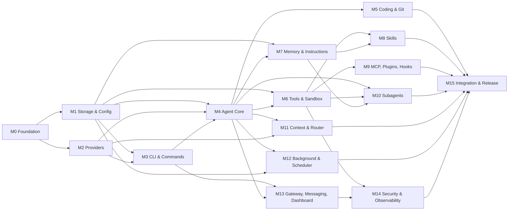

# IMPLEMENTATION-ROADMAP. Rann Code V1

- Dokumen induk: MASTER.md
- Versi: 1.0
- Prinsip: seluruh milestone adalah bagian dari V1. Tidak ada fitur yang ditunda ke V2.
- Requirement: seluruh RC-FR
- Acceptance: ACCEPTANCE-CRITERIA.md

## 1. Cara membaca roadmap

Roadmap ini mengatur urutan membangun, bukan memotong fitur. Setiap milestone menghasilkan bagian yang bisa dijalankan dan diuji, tetapi V1 baru dinyatakan selesai jika semua milestone lulus gate-nya.

Estimasi memakai satuan orang-minggu untuk satu engineer senior yang sudah familiar dengan TypeScript dan sistem agent. Estimasi bukan janji; ia dipakai untuk merencanakan dependency dan risiko.

## 2. Dependency graph milestone

Critical path: M0 -> M1 -> M4 -> M6 -> M10 -> M15. M13 dan M14 bisa berjalan paralel setelah M4 dan M6 stabil.

## 3. Milestone

### M0. Foundation dan runtime

Tujuan: monorepo, build, tipe, error, event, logging, dan kerangka daemon yang bisa start dan berkomunikasi dengan CLI.

Deliverable:

- Monorepo pnpm dengan package `core`, `shared`, `storage`, `runtime`, `cli`, `tui`.
- TypeScript strict, ESLint, Prettier, Vitest, dependency-cruiser.
- Skema Zod untuk config, event, error.
- JSON-RPC server dan client minimal (`health`, `shutdown`).
- Daemon start, socket, graceful shutdown.
- CLI `rann --version`, `rann doctor` minimal.
- CI: build, lint, unit test, dependency check.
- Struktur `~/.rann/` dibuat dengan permission benar.

Definition of done:

- `pnpm build` menghasilkan binary `rann` dan `rannd`.
- `rann doctor` melaporkan versi, socket, dan permission.
- Daemon start < 800 ms, shutdown < 1 detik.
- Tes unit untuk error mapping dan config schema lulus.
- Tidak ada import terlarang antar package.

Estimasi: 2 orang-minggu.

### M1. Storage, config, dan migrasi

Tujuan: SQLite sebagai sumber kebenaran, skema lengkap, repository pattern, migrasi, backup.

Deliverable:

- Skema database sesuai ARCHITECTURE bagian 9.3, termasuk FTS dan vec.
- Migrasi versioned dengan checksum.
- Repository untuk session, message, turn, task, plan, tool call, approval, audit, usage.
- Config hierarchy dan `/config explain`.
- Backup `VACUUM INTO`, restore, integrity check.
- Seed profile default.

Definition of done:

- Database baru dibuat dari nol dan dari fixture versi sebelumnya.
- Migrasi gagal memulihkan backup otomatis.
- 1 juta pesan sintetis: query terbaru < 50 ms.
- FTS dan vec tetap sinkron setelah insert, update, delete.
- Backup dan restore lulus tes integritas.

Estimasi: 2,5 orang-minggu.

### M2. Provider layer dan model registry

Tujuan: abstraksi provider, adapter nyata, streaming, tool calling, usage, health.

Deliverable:

- Interface adapter dan event normalisasi.
- Adapter `anthropic`, `openai-responses`, `openai-chat`, `gemini`, `openai-compatible`, `mock`.
- Model registry dengan capability dan harga.
- Secret store terenkripsi dan keychain.
- Provider health, rate limit, circuit breaker.
- `/provider`, `/model`, `/models` command dasar.
- Tes kontrak terhadap mock dan rekaman response.

Definition of done:

- Semua adapter lulus tes kontrak: streaming, tool call, error map, usage.
- Mock provider bisa menghasilkan skenario sukses, timeout, 429, 500, dan tool call invalid.
- Tidak ada API key di log atau database plaintext.
- Model tanpa capability tool ditolak untuk agentic mode.

Estimasi: 3 orang-minggu.

### M3. CLI, TUI, dan command registry

Tujuan: pengalaman terminal lengkap sesuai dokumen 02.

Deliverable:

- Ink renderer, layout, status bar, transcript.
- Input multiline, history, `@`, `!`, `$EDITOR`.
- Command palette fuzzy dan autocomplete kontekstual.
- Approval dialog.
- Streaming Markdown dan tool display.
- Non-interaktif, JSON, stream-json, pipe.
- Registry 97 command dengan skema dan help.
- Tema dan fallback terminal.

Definition of done:

- Seluruh command di registry muncul di `/help` dan bisa dipanggil.
- Command invalid menghasilkan error contract, bukan crash.
- Resize 40x20 sampai 200x60 tidak merusak layout.
- `rann -p ... --output-format json` menghasilkan JSON valid.
- Pipe `echo "..." | rann -p ...` bekerja.
- Tes snapshot untuk 20 layar utama.

Estimasi: 4 orang-minggu.

### M4. Agent core dan planning

Tujuan: loop agent, task graph, approval, checkpoint, verifikasi.

Deliverable:

- State machine dan task events.
- Planner dengan skema DAG dan validasi.
- Executor dan tool broker.
- Verifier.
- Checkpoint dan recovery.
- Goal tracking.
- Failure analysis.
- Budget dan step limit.
- `/plan`, `/execute`, `/tasks`, `/cancel`.

Definition of done:

- Agent menyelesaikan tugas fixture 10 langkah dan berhenti dengan bukti.
- Kill -9 saat task berjalan, restart, task pulih ≤ 5 detik.
- Rencana dengan siklus ditolak.
- Task tanpa kriteria selesai tidak bisa `done`.
- Approval plan menghalangi semua tool tulis.

Estimasi: 4 orang-minggu.

### M5. Coding engine dan Git

Tujuan: kemampuan coding end-to-end dengan patch aman dan verifikasi.

Deliverable:

- File tree, symbol index tree-sitter, text index, vector index opsional.
- `read_file`, `write_file`, `edit_file`, `delete_file`.
- Patch protocol dengan hash dan verifikasi.
- Multi-file transaction.
- Adapter build/test/lint per ekosistem.
- Git service, checkpoint, worktree, diff, commit, push/pull dengan izin.
- `/init`, `/review`, `/test`, `/debug`, `/git`, `/checkpoint`, `/undo`.

Definition of done:

- Patch yang gagal tidak mengubah file.
- Multi-file transaction rollback bersih.
- Refactor fixture 20 file lulus tes.
- Checkpoint restore mengembalikan file dan state.
- `git reset --hard` dan force push diblokir tanpa approval.

Estimasi: 4,5 orang-minggu.

### M6. Tools dan sandbox

Tujuan: registry tool lengkap, eksekusi aman, izin, timeout, log.

Deliverable:

- Tool registry dan schema validation.
- 16 kategori tool, minimal 40 tool bawaan.
- Sandbox Linux/macOS/Windows.
- Policy engine dan rule matching.
- Shell parser dan deteksi perintah berbahaya.
- Tool chaining.
- Tool kustom project.
- `/tools`, `/tool`, `/permissions`, `/sandbox`.

Definition of done:

- Tool call dengan argumen invalid tidak dieksekusi.
- `read-only` memblokir shell, tulis, dan jaringan.
- Path traversal dan symlink keluar workspace ditolak.
- Perintah `rm -rf /` diblokir di semua mode tanpa persetujuan khusus.
- Tool timeout membunuh seluruh process group.
- Audit mencatat setiap tool call.

Estimasi: 4 orang-minggu.

### M7. Memory dan instruction system

Tujuan: memory enam ruang, retrieval hybrid, ekstraksi, audit, instruksi berlapis.

Deliverable:

- Skema memory dan versi.
- Ekstraksi kandidat dan antrean persetujuan.
- FTS + vec + RRF.
- Embedding background queue dan reindex.
- Konsolidasi, dedup, expiry.
- Import/export.
- Loader instruksi RANN.md, AGENTS.md, CLAUDE.md, rules per path.
- `/memory`, `/remember`, `/recall`, `/forget`, `/profile`, `/context`.

Definition of done:

- Memory yang disimpan bisa ditemukan kembali dengan query relevan.
- Memory tidak relevan tidak masuk prompt.
- Dedup mencegah entri identik.
- Hapus memory menghapus FTS dan vec.
- Konflik instruksi dicatat dengan pemenang.
- Retrieval 50.000 entri < 80 ms p95.

Estimasi: 4 orang-minggu.

### M8. Skills

Tujuan: skill discovery, loading, execution, creation, registry.

Deliverable:

- Parser SKILL.md dan validasi.
- Progressive loading.
- Aktivasi berbasis trigger.
- Eksekusi skrip dengan sandbox.
- `/create-skill`, `/install-skill`, `/skills`, `/skill`.
- Registry lokal, HTTPS, Git.
- Versioning dan checksum.
- Efektivitas skill.

Definition of done:

- Skill dengan nama bentrok ditolak.
- Skill tanpa trigger tidak lolos validasi.
- Skill dari sumber tidak tepercaya meminta persetujuan.
- Skill tidak bisa menaikkan permission.
- Rollback versi bekerja.

Estimasi: 3 orang-minggu.

### M9. MCP, plugin, dan hooks

Tujuan: ekosistem eksternal yang aman dan bisa diperluas.

Deliverable:

- MCP client stdio dan Streamable HTTP.
- OAuth 2.1 dan header auth.
- Discovery, namespacing, health, reconnect.
- Plugin manifest, loader, API, isolasi proses.
- Hook engine 16 event, empat tipe, timeout, dry-run.
- `/mcp`, `/plugins`, `/hooks`.

Definition of done:

- MCP server mati tidak menjatuhkan sesi.
- Tool MCP tidak mendapat izin implisit.
- Plugin tanpa izin tidak bisa membaca secret.
- Hook `PreToolUse` bisa memblokir tool.
- Hook timeout mengikuti kebijakan `onError`.
- Dry-run menampilkan payload tanpa eksekusi.

Estimasi: 4 orang-minggu.

### M10. Subagents dan orkestrasi

Tujuan: multi-agent yang aman, paralel, dan tidak konflik.

Deliverable:

- Profil agent dan spawn protocol.
- Parallel executor dengan concurrency limit.
- Shared/isolated context.
- Agent messaging.
- Path lease dan merge queue.
- Lifecycle, cancel, recovery.
- Monitoring dan transcript.
- `/agents`, `/agent`, `/delegate`.

Definition of done:

- 8 agen paralel menyelesaikan tugas tanpa konflik file.
- Dua agen yang menulis file sama menghasilkan lease conflict yang ditangani.
- Cancel parent membatalkan semua anak.
- Agen orphan terdeteksi dalam 30 detik.
- Budget parent membatasi total biaya anak.

Estimasi: 4 orang-minggu.

### M11. Context intelligence dan router

Tujuan: konteks relevan, compaction aman, routing transparan.

Deliverable:

- Token estimator dan kalibrasi.
- Budget zona.
- Retrieval file dinamis.
- Compaction dan ringkasan.
- Overflow recovery.
- Prompt caching.
- Router skor dan policy.
- `/route`, `/cost`, `/usage`, `/budget`, `/compact`.

Definition of done:

- Context 100.000 token tidak overflow.
- Compaction mempertahankan goal, keputusan, error, path, dan verifikasi.
- Router tidak mengganti model pinned.
- Fallback tercatat dan bisa dijelaskan.
- Biaya per task akurat untuk model berharga diketahui.
- Estimasi token dalam 15 persen dari usage aktual.

Estimasi: 3,5 orang-minggu.

### M12. Background task dan scheduler

Tujuan: pekerjaan yang bertahan tanpa terminal dan jadwal yang andal.

Deliverable:

- Job queue SQLite dan worker pool.
- Idempotency, retry, dead letter.
- Recovery setelah restart.
- Notifikasi.
- Scheduler cron, interval, one-time, event.
- Timezone dan DST.
- `/background`, `/scheduler`, `/queue`, `/logs`.

Definition of done:

- Job tetap berjalan setelah terminal ditutup.
- Kill -9 worker, job dipulihkan atau ditandai gagal dengan benar.
- Job dengan idempotency key sama tidak dobel.
- Cron `0 7 * * *` di Asia/Jakarta berjalan tepat.
- DST tidak menjalankan job dua kali.
- Overlap policy `skip` bekerja.

Estimasi: 3,5 orang-minggu.

### M13. Gateway, messaging, dan dashboard

Tujuan: akses remote yang aman dan dashboard yang konsisten.

Deliverable:

- Gateway Fastify, REST, WebSocket.
- Pairing, token hash, scope, revoke.
- Session dan task routing, event replay.
- Telegram, Discord, Slack, web chat.
- Dashboard React dengan 17 halaman.
- Approval dari messaging dan dashboard.
- `/gateway`, `/devices`, `/pair`, `/dashboard`, `/integrations`.

Definition of done:

- Gateway menolak bind publik tanpa auth.
- Pairing code sekali pakai dan kedaluwarsa.
- Token viewer tidak bisa approve.
- Reconnect mengirim event yang terlewat.
- Sesi Telegram per topic terpisah.
- Dashboard dan CLI melihat state yang sama.
- Approval dari Telegram tercatat di audit.

Estimasi: 5 orang-minggu.

### M14. Security hardening dan observability

Tujuan: pertahanan berlapis, audit, dan operasi yang bisa dipercaya.

Deliverable:

- Sandbox di tiga platform.
- Secret rotation.
- Prompt injection labeling.
- Audit hash chain.
- Isolasi plugin dan MCP.
- Backup otomatis dan restore teruji.
- Log, metrics, trace, doctor lengkap.
- `/doctor`, `/health`, `/metrics`, `/privacy`, `/support`.

Definition of done:

- Tidak ada secret di log, DB, atau trace.
- Audit mendeteksi perubahan entri.
- Plugin tidak bisa membaca state sesi lain.
- Restore dari backup lulus integrity check.
- `rann doctor` menemukan dan memperbaiki masalah umum.
- Prompt injection fixture tidak mengeksekusi aksi tanpa approval.

Estimasi: 3,5 orang-minggu.

### M15. Integration, performance, dan rilis

Tujuan: semua bagian bekerja bersama, performa terukur, distribusi siap.

Deliverable:

- End-to-end test seluruh alur.
- Benchmark dan optimasi.
- Dokumentasi pengguna dan command reference.
- Paket npm, binary, Docker, Homebrew.
- Signature dan checksum.
- Migrasi dari versi beta.
- Release checklist.

Definition of done:

- Semua RC-AC lulus otomatis atau prosedur manual terdokumentasi.
- Benchmark memenuhi RC-NFR atau penyimpangan dijelaskan.
- Instalasi bersih di Linux, macOS, Windows.
- Upgrade dari versi sebelumnya tidak kehilangan data.
- `rann doctor` bersih setelah instalasi.
- Tidak ada placeholder atau fitur UI palsu.

Estimasi: 4 orang-minggu.

## 4. Ringkasan estimasi

| Milestone | Orang-minggu |
|---|---|
| M0 | 2,0 |
| M1 | 2,5 |
| M2 | 3,0 |
| M3 | 4,0 |
| M4 | 4,0 |
| M5 | 4,5 |
| M6 | 4,0 |
| M7 | 4,0 |
| M8 | 3,0 |
| M9 | 4,0 |
| M10 | 4,0 |
| M11 | 3,5 |
| M12 | 3,5 |
| M13 | 5,0 |
| M14 | 3,5 |
| M15 | 4,0 |
| Total | 60,5 |

Dengan satu engineer: sekitar 14 bulan. Dengan dua engineer yang bisa bekerja paralel pada M2/M3, M6/M7, M8/M9, M12/M13: sekitar 8 sampai 9 bulan. Estimasi ini belum termasuk waktu menunggu akses provider, review keamanan eksternal, atau desain UI khusus.

## 5. Urutan kerja yang disarankan

1. M0 dan M1 bersamaan.
2. M2 selesai sebelum M4, karena agent butuh provider.
3. M3 bisa paralel dengan M2, memakai mock provider.
4. M4 adalah titik integrasi pertama: CLI bisa menjalankan tugas dengan mock.
5. M5, M6, M7 bisa berjalan paralel setelah M4 stabil.
6. M8 dan M9 setelah M6 dan M7.
7. M10 setelah M4, M6, dan M7.
8. M11 setelah M2 dan M4.
9. M12 setelah M1 dan M4.
10. M13 setelah M3 dan M4, tetapi sebelum M14.
11. M14 setelah M6 dan M13.
12. M15 terakhir, setelah semua gate lulus.

## 6. Gate kualitas per milestone

Setiap milestone wajib melewati gate berikut sebelum dianggap selesai:

- **Build gate**: build bersih, tidak ada error TypeScript, tidak ada dependency terlarang.
- **Test gate**: unit dan integration lulus, coverage paket inti ≥ 80 persen.
- **Contract gate**: skema API dan event tidak berubah tanpa versi.
- **Security gate**: tidak ada secret di log, tidak ada tool tanpa permission, tidak ada path traversal.
- **Recovery gate**: kill -9 saat operasi kritis, state konsisten setelah restart.
- **Docs gate**: README, changelog, dan command reference diperbarui.
- **Demo gate**: alur utama bisa didemokan tanpa mock pada provider nyata.

## 7. Risiko dan mitigasi

| Risiko | Dampak | Mitigasi |
|---|---|---|
| Perbedaan API provider berubah | Adapter rusak | Tes kontrak, capability registry, versi adapter |
| Context window tidak cukup untuk repo besar | Kualitas turun | Retrieval, compaction, model dengan context besar |
| Multi-agent konflik | File rusak | Lease, hash, merge queue, worktree |
| Sandbox tidak tersedia | Keamanan turun | Fallback `ask`, peringatan, container |
| Gateway disalahgunakan | Akses tidak sah | Pairing, scope, rate limit, TLS |
| SQLite menjadi bottleneck | Latensi | WAL, indeks, worker read, arsip sesi |
| Biaya model melonjak | Budget habis | Router, budget, alert, model murah untuk ekstraksi |
| Plugin jahat | Data bocor | Proses terpisah, permission, signature |
| Migrasi database gagal | Data hilang | Backup wajib, checksum, restore teruji |
| Dokumentasi tidak konsisten | Implementasi salah | ID FR/AC, audit lintas dokumen, review |
| Scope terlalu besar | V1 tidak selesai | Milestone terukur, gate, tidak menambah fitur di luar PRD |

## 8. Definition of done V1

V1 dinyatakan selesai jika:

1. Semua 151 FR punya implementasi dan tes atau prosedur verifikasi.
2. Semua 151 AC lulus.
3. Tidak ada fitur yang hanya ada di UI tanpa backend.
4. Tidak ada placeholder, `TODO`, atau `not implemented` di jalur yang bisa diakses pengguna.
5. Semua provider yang dijanjikan bisa dipakai minimal untuk chat dan tool calling.
6. Gateway, messaging, dan dashboard berbagi state yang sama dengan CLI.
7. Recovery setelah crash terbukti untuk task, job, dan gateway.
8. Audit dan secret management lulus review keamanan internal.
9. Dokumentasi pengguna dan referensi command tersedia.
10. Instalasi bersih berhasil di tiga platform.
